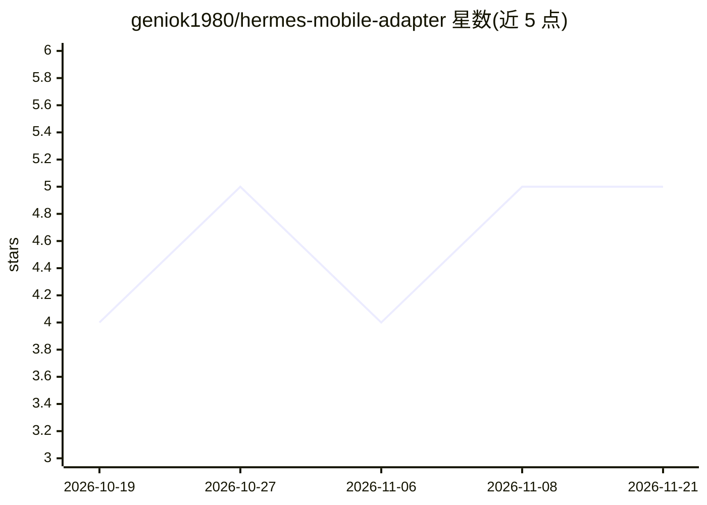

# geniok1980/hermes-mobile-adapter

⭐ 5 · Python · MIT · 推送 2026-11-16 · [GitHub](https://github.com/geniok1980/hermes-mobile-adapter) · 个人维护

**把 Hermes Agent 接入移动应用的 WS 适配器与 TS/Python SDK**

为 Hermes Agent 提供平台级 WebSocket 适配器插件与客户端 SDK：移动应用（Swift/Kotlin/RN/Flutter/Web）经 ws(s)://主机:8787/ws 直连代理网关，无需自建后端，消息进入代理既有会话、工具与记忆。协议 v1 覆盖文本分片、双向语音与媒体（单文件 8MB 上限）、按钮卡片确认、按 id 编辑的流式输出、打印中指示与头像状态（thinking→speaking→idle）。仓库含 Python 插件、TypeScript/npm SDK、Python asyncio 客户端、网页示例与 130 项测试。适配器需安装到 Hermes Agent 环境。

## 筛选速览

| 维度 | 判定 | 备注 |
|---|---|---|
| AI 角色 | `ai-ecosystem` | LLM/agent 周边工具 |
| 许可风险 | `permissive` | MIT |
| 部署形态 | `library` | 以包/库形式分发 |
| 模型依赖 | — | README 未给出锁定关系 |
| 硬件要求 | — | 无带数字的原话,不猜 |
| 安装摩擦 | `low` | 无编译、无系统依赖或容器化 |
| 成熟度 | — | 结构信号不足 |

## 能力要点

- 平台级 WS 适配器：网关内起 WebSocket 服务器，协议帧转为 MessageEvent
- TypeScript SDK 发布 npm（hermes-mobile-client），另有 Python asyncio 客户端
- 双向媒体、语音（WAV/OGG）、按钮卡片确认与流式消息编辑
- MOBILE_TOKEN 自动生成并经 Telegram 发送配对卡片

## 适用场景

- 让手机 App 直接与自己的 Hermes Agent 对话
- 为 RN/Expo/Flutter/Swift/Kotlin 应用集成代理聊天界面
- 在浏览器中无代码试用代理（examples/web 页面）
- 需要语音与文件双向传输的代理交互

## 场景标签

`聊天机器人` `AI 助手` `语音 Agent` · 领域:对话与助手

## 证据(README 行号)

> L16: Адаптер — обычная платформа Hermes: он поднимает WebSocket-сервер внутри шлюза и
> L133: - Hermes Agent (адаптер использует его платформенный API);

## 星数曲线

2026-10-19 4 → 2026-11-21 5（+1）

---
*卡片 v1 · prompt 1.4 · 生成 2026-11-21 · 置信度 high · 依据 README sha `9e93bdff23ba` · [字段定义](../../DATASET.md)*
