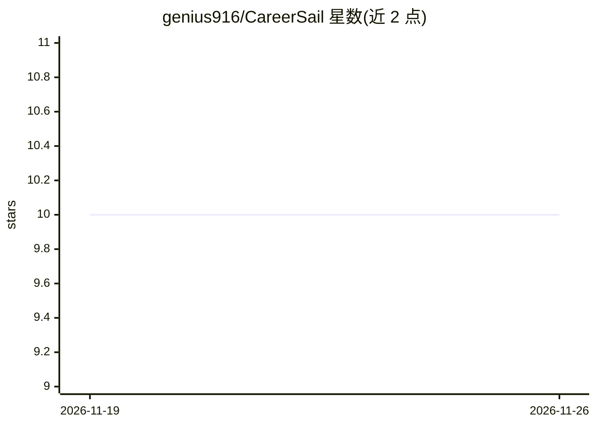

# genius916/CareerSail

⭐ 10 · JavaScript · MIT · 推送 2026-09-16 · [GitHub](https://github.com/genius916/CareerSail) · 个人维护 · 中文 README

**AI Agent 驱动的秋招求职看板：搜岗位、追进度、管投递**

本地运行的 Node.js 求职进度管理看板，数据以 CSV 存储并可用 Excel 编辑。核心机制是通过 AI Agent（如 Claude Code、Trae 等）配合 Playwright MCP 浏览器自动化访问公司校招官网获取真实岗位，通过 lark-cli 从飞书多维表格同步秋招公司库，按用户画像过滤后写入看板。用户以自然语言与 Agent 对话完成搜索、筛选与进度记录；也可在未配置 Agent 工具时切换手动搜索模式。提供 Windows 一键启动与开机自启动脚本。

## 筛选速览

| 维度 | 判定 | 备注 |
|---|---|---|
| AI 角色 | `ai-native` | 本体是模型或模型工具 |
| 许可风险 | `permissive` | MIT |
| 部署形态 | `library` | 以包/库形式分发 |
| 模型依赖 | — | README 未给出锁定关系 |
| 硬件要求 | — | 无带数字的原话,不猜 |
| 安装摩擦 | `low` | 无编译、无系统依赖或容器化 |
| 成熟度 | — | 结构信号不足 |

## 能力要点

- 通过 Playwright MCP 浏览器自动化访问校招官网并直达 JD 详情页
- lark-cli 从飞书 Base 同步秋招公司库
- 按用户画像（专业/城市/方向）过滤与匹配岗位
- CSV 存储、跨 Agent 兼容（Trae/Claude Code/Codex/Cursor 等）

## 适用场景

- 秋招期间集中管理校招岗位发现与投递进度
- 让 AI Agent 根据我的专业背景帮我搜索匹配岗位
- 用时间线看板追踪简历筛选到 Offer 各阶段

## 场景标签

`浏览器自动化` · 领域:效率与自动化

## 证据(README 行号)

> L3: > AI Agent 驱动的求职看板 —— 岗位智能发现、进度追踪、一键投递。
> L48: **为什么需要**：岗位搜索不是内置爬虫，而是通过 Playwright MCP 驱动浏览器访问官网 API。没有这个工具，搜索 API 会返回空结果。
> L167: **只需跟 AI Agent 对话。** 就像现在这样，用自然语言告诉它你的情况，Agent 会帮你搜岗位、管进度、记录每一步。

## 星数曲线

2026-11-19 10 → 2026-11-26 10（+0）

---
*卡片 v1 · prompt 1.4 · 生成 2026-11-19 · 置信度 mid · 依据 README sha `c71d39a850e3` · [字段定义](../../DATASET.md)*
