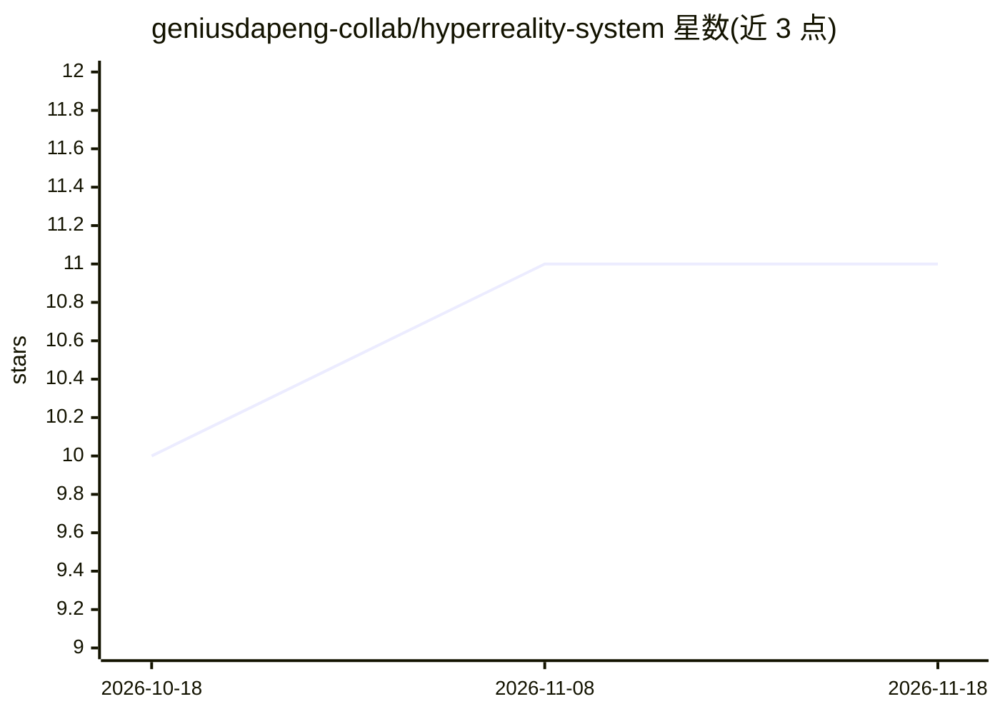

# geniusdapeng-collab/hyperreality-system

⭐ 11 · TypeScript · Apache-2.0 · 推送 2026-10-24 · [GitHub](https://github.com/geniusdapeng-collab/hyperreality-system) · [官网](https://github.com/geniusdapeng-collab/hyperreality-system) · 组织维护 · 中文 README

**面向视频社媒营销者的 AI 制作与经营多 agent 系统**

开源的 AI 视频制作经营系统，内置 33 个岗位的 AI 班组（制作 21 + 经营 12），覆盖选题调研、剧本、分镜、定妆照锚定、渲染、后期、发布与评论运营全链路。机制上以 25/30 字段结构化镜头卡、渲染前导演评审、事实红线闸机、五元事件哈希链账本与围栏授权为核心；默认以 Mock 模拟态运行，接入真实模型需经落地向导配置。安装需 Node 工具链（pnpm）与 PostgreSQL 17（含 pgvector，docker compose 自动建容器）。

## 筛选速览

| 维度 | 判定 | 备注 |
|---|---|---|
| AI 角色 | `ai-native` | 本体是模型或模型工具 |
| 许可风险 | `permissive` | Apache-2.0 |
| 部署形态 | `self-host` | docker 或自建部署 |
| 模型依赖 | locked-api |  |
| 硬件要求 | — | 无带数字的原话,不猜 |
| 安装摩擦 | `low` | 无编译、无系统依赖或容器化 |
| 成熟度 | — | 结构信号不足 |

## 能力要点

- 33 岗位 AI 班组与人机混编通讯录（/agents），含围栏授权对账与 30 天战绩档案
- 25/30 字段镜头卡 + 渲染前 6 问评审与 5 维评分，生成前拦截
- Seedance → 可灵 → 即梦渲染供应商降级链，异步任务制全程留痕
- 五元事件 append-only + SHA-256 哈希链事件账本与组织记忆

## 适用场景

- 从选题到发布的短视频批量生产与多平台分发
- 把社媒账号托管给系统做自动化经营与评论运营
- 以质检模式（只读扫描）先体检账号再决定托管

## 场景标签

`多智能体` `视频生成` `工作流自动化` · 领域:Agent 开发

## 证据(README 行号)

> L25: HyperReality 是一套**开源的 AI 视频制作智能经营系统**：它把「AI 生成视频」从碰运气的抽卡游戏，升级为一条有班组、有纪律、有账本的内容生产线。
> L63: 制作班组 21 个岗位（总导演 / 情报五站 / 创意策划 / 制片人 / 剧本师 / 剧本连贯审查 / 视觉语言 / 场景设计 / 分镜 / 提示词工程 / 微动作增强 / 定妆照美术 / 渲染 / 剪辑 / 片头 / 音频 /
> L102: - 模型自由：任意 OpenAI 兼容端点（DeepSeek / Kimi / 智谱 / OpenAI），按成本 / 时延 / 任务类型三维权衡

## 星数曲线

2026-10-18 10 → 2026-11-18 11（+1）

---
*卡片 v1 · prompt 1.4 · 生成 2026-11-18 · 置信度 high · 依据 README sha `d8f770d69544` · [字段定义](../../DATASET.md)*
