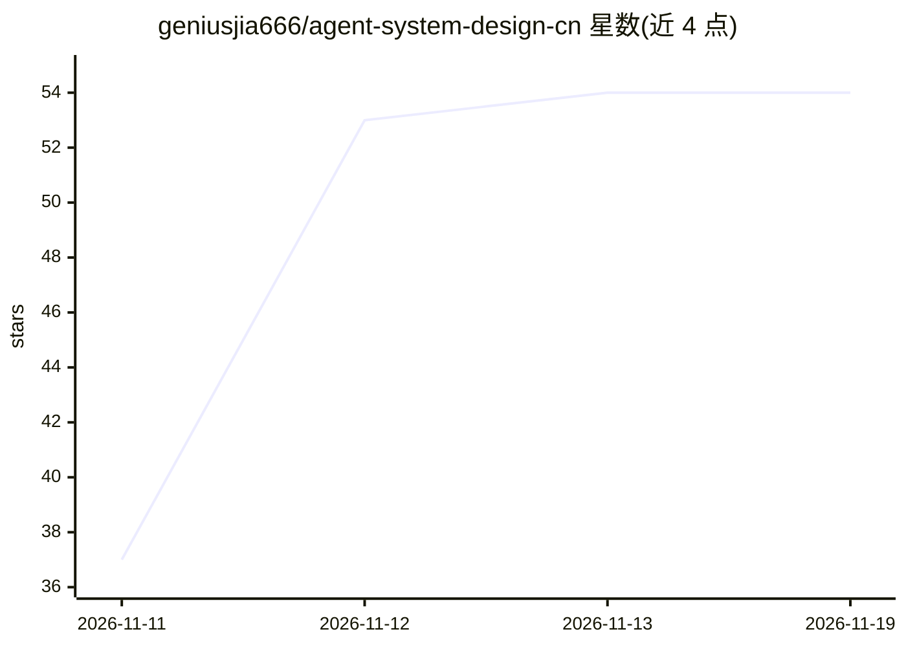

# geniusjia666/agent-system-design-cn

⭐ 54 · Python · MIT · 推送 2026-11-10 · [GitHub](https://github.com/geniusjia666/agent-system-design-cn) · 个人维护 · 中文 README

**Agent 系统设计方法论 Skill：产出可评审的架构方案**

供 Agent 宿主加载的设计与评审 Skill：以 SKILL.md 为入口、references/ 与 assets/ 为参考材料，提供 7 步设计流程（需求澄清到交付自检）、4 档复杂度选择（提示词/工作流/单 Agent/多 Agent）、21 种设计模式与 21 维自检清单，以及含 7 要素的 dispatch 交接契约（由宿主执行，文件本身不运行）。另附 Google ADK、LangGraph、CrewAI、AutoGen Core 的框架落地映射笔记（未安装测试）。明确声明不运行 Agent、不是编排框架、不负责业务代码与部署；安装位置以各宿主文档为准，未做加载验证。

## 筛选速览

| 维度 | 判定 | 备注 |
|---|---|---|
| AI 角色 | `ai-knowledge` | 知识聚合/清单类 |
| 许可风险 | `permissive` | MIT |
| 部署形态 | `None` |  |
| 模型依赖 | — | README 未给出锁定关系 |
| 硬件要求 | — | 无带数字的原话,不猜 |
| 安装摩擦 | `low` | 无编译、无系统依赖或容器化 |
| 成熟度 | — | 结构信号不足 |

## 能力要点

- 7 步设计流程与 4 档复杂度选择（够用即止，多 Agent 需隔离理由）
- 21 种设计模式与 21 维自检清单（不适用维度不打分）
- dispatch/handoff/gate 交接契约字段定义，由宿主执行
- 附 Google ADK、LangGraph、CrewAI、AutoGen Core 框架映射笔记

## 适用场景

- 接到需求后先判断是否需要多 Agent，再产出架构设计文档
- 按 21 维清单评审已有的 Agent 系统方案
- 将交接契约对照到具体框架的构建骨架

## 场景标签

`提示工程` · 领域:Agent 开发

## 证据(README 行号)

> L5: 这是一份用来设计和评审的 Skill。它把需求写成可评审的方案，或按清单检查已有方案。它不运行 Agent，不是编排框架，也不负责业务代码、部署或发布。
> L29: 安装单元是整个目录 `skills/agent-system-design-cn/`。宿主若按「一个目录加一份带 YAML frontmatter 的 SKILL.md」加载技能，就把这个目录放到该宿主自己文档所写的位置。`ref

## 星数曲线

2026-11-11 37 → 2026-11-19 54（+17）

---
*卡片 v1 · prompt 1.4 · 生成 2026-11-18 · 置信度 high · 依据 README sha `1e0865125c21` · [字段定义](../../DATASET.md)*
