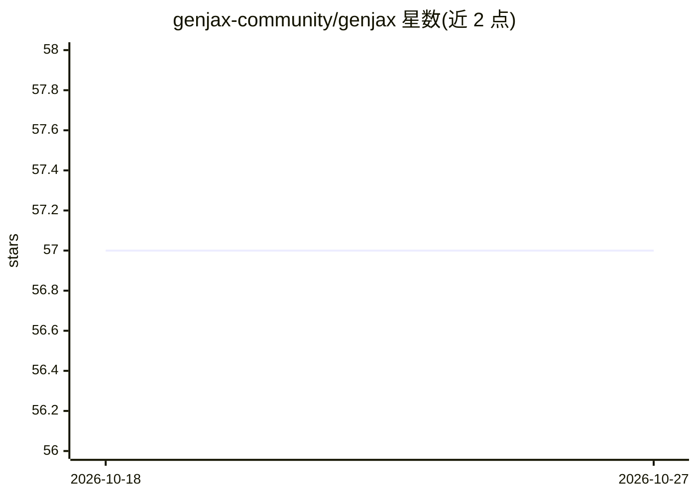

# genjax-community/genjax

⭐ 57 · Python · Apache-2.0 · 推送 2026-03-19 · [GitHub](https://github.com/genjax-community/genjax) · [官网](http://genjax.gen.dev/) · 组织维护

**面向科研开发者的 JAX 概率编程库，可编程推断、GPU 并行**

MIT 概率计算项目 Gen 语言在 JAX 上的实现（社区版）：以生成函数表示结构化样本空间上的概率测度，支持以编程方式构造与操作生成函数，并通过 JIT 编译与自动批处理将推断计算放到 GPU 上运行。示例演示了 Beta-Bernoulli 模型与采样重要性重采样（SIR）推断。README 明确声明本社区版进入 sunsetting 阶段（维护团队已解散），并指向 femtomc/genjax 作为持续维护版本。Apache 2.0 许可，以 pip 包形式提供。

## 筛选速览

| 维度 | 判定 | 备注 |
|---|---|---|
| AI 角色 | `ai-native` | 本体是模型或模型工具 |
| 许可风险 | `permissive` | Apache-2.0 |
| 部署形态 | `library` | 以包/库形式分发 |
| 模型依赖 | — | README 未给出锁定关系 |
| 硬件要求 | — | 无带数字的原话,不猜 |
| 安装摩擦 | `low` | 无编译、无系统依赖或容器化 |
| 成熟度 | `idea` | |

## 能力要点

- Gen 语言的 JAX 实现，基于生成函数的概率编程
- 可编程推断 + JIT 编译与自动批处理到 GPU
- 支持 CPU/CUDA 两种 JAX 后端安装
- README 声明本社区版进入 sunsetting，维护版移至 femtomc/genjax

## 适用场景

- 构建贝叶斯模型并做自定义推断（如重要性重采样）
- 在 GPU 上并行运行批量化概率推断实验
- 科研场景下探索 Gen 生态的多范式概率编程

## 场景标签

 · 领域:机器学习/概率编程

## 证据(README 行号)

> L21: Gen is a multi-paradigm (generative, differentiable, incremental) language for probabilistic programming focused on
> L23: GenJAX is an implementation of Gen on top of JAX - exposing the ability to programmatically construct and manipulat

## 星数曲线

2026-10-18 57 → 2026-10-27 57（+0）

---
*卡片 v1 · prompt 1.4 · 生成 2026-10-24 · 置信度 high · 依据 README sha `1133f412cf8f` · [字段定义](../../DATASET.md)*
