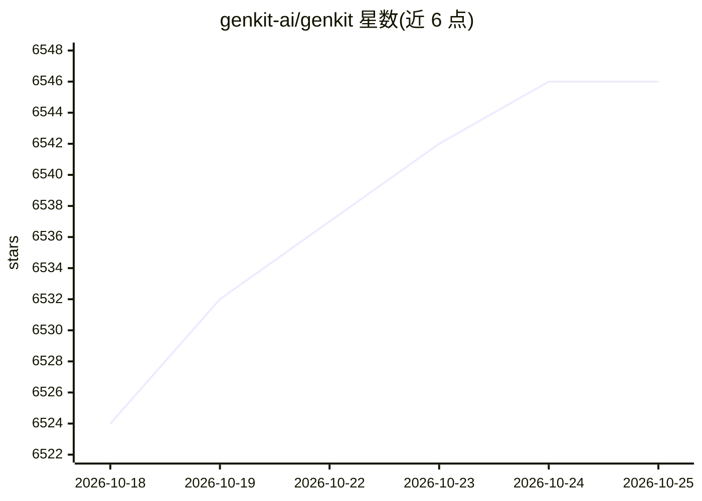

# genkit-ai/genkit

⭐ 6,546 · TypeScript · Apache-2.0 · 推送 2026-10-24 · [GitHub](https://github.com/genkit-ai/genkit) · [官网](https://genkit.dev) · 组织维护

**Google 出品的跨语言 AI 应用开发框架，构建 agent 与 RAG**

Google Firebase 团队构建并用于生产的开源框架，提供 JavaScript/TypeScript、Go（生产可用）、Python（Beta）、Dart（Preview）SDK。通过统一接口接入 Google、OpenAI、Anthropic、Ollama 等多家模型，支持结构化输出、工具调用、多模态输入输出、RAG 与 agent 工作流。附带本地 CLI 与 Developer UI 用于测试、评估、调试执行轨迹，并提供生产监控面板。可部署到 Firebase、Cloud Run 或任意支持所选语言的环境。

## 筛选速览

| 维度 | 判定 | 备注 |
|---|---|---|
| AI 角色 | `ai-ecosystem` | LLM/agent 周边工具 |
| 许可风险 | `permissive` | Apache-2.0 |
| 部署形态 | `library` | 以包/库形式分发 |
| 模型依赖 | local-ok | 支持本地模型 |
| 硬件要求 | — | 无带数字的原话,不猜 |
| 安装摩擦 | `low` | 无编译、无系统依赖或容器化 |
| 成熟度 | `idea` | |

## 能力要点

- 统一接口接入 Google/OpenAI/Anthropic/Ollama 等多提供商模型
- 四种语言 SDK：JS/TS 与 Go 生产可用，Python Beta、Dart Preview
- 本地 CLI 与 Developer UI 支持运行、评估与执行轨迹调试
- 支持结构化输出、工具调用、RAG 与 agent 工作流

## 适用场景

- 构建聊天机器人、自动化流程与推荐系统等全栈 AI 应用
- 在多种模型提供商间切换并对比输出
- 通过 Developer UI 测试提示词与调试多步 agent 流程

## 场景标签

`Agent 框架` `RAG` · 领域:Agent 开发

## 证据(README 行号)

> L4: Genkit is an open-source framework for building full-stack AI-powered applications, built and used in production by 
> L11: It offers a unified interface for integrating AI models from providers like Google, OpenAI, Anthropic, Ollama, and 
> L43:  Broad AI model support

## 星数曲线

2026-10-18 6,524 → 2026-10-25 6,546（+22）

---
*卡片 v1 · prompt 1.4 · 生成 2026-10-20 · 置信度 high · 依据 README sha `a28758423a46` · [字段定义](../../DATASET.md)*
