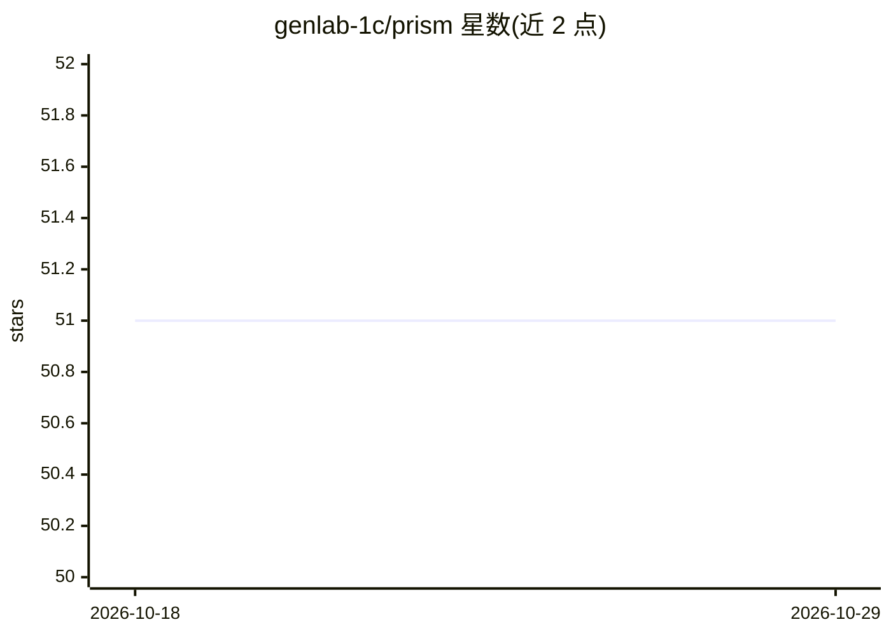

# genlab-1c/prism

⭐ 51 · Python · MIT · 推送 2026-10-24 · [GitHub](https://github.com/genlab-1c/prism) · [官网](http://prism.genlab-1c.ru/) · 组织维护

**LLM 生成 1С:Предприyme (BSL) 代码的可执行基准测试与排行榜**

PRISM 是一个开放的可执行基准测试：让各类 LLM（Claude、GPT、Gemini、GigaChat、YandexGPT 等）编写 1С:Предприятие 平台的 BSL 代码，并通过编译器、隐藏测试与 headless-1С 在 Docker 中的实际执行来评分。评分按 SMOP 四轴（语法、语义、最优性、平台）输出向量而非单一分数。面向 1С 开发者与研究者选型；含 35 个任务、174 个测试用例、60 个模型的排行榜。需要 Docker、Python 3.10+、make；平台类任务需自带 1С 教育版发行版与模型 API 密钥。

## 筛选速览

| 维度 | 判定 | 备注 |
|---|---|---|
| AI 角色 | `ai-ecosystem` | LLM/agent 周边工具 |
| 许可风险 | `permissive` | MIT |
| 部署形态 | `self-host` | docker 或自建部署 |
| 模型依赖 | local-ok | 支持本地模型 |
| 硬件要求 | — | 无带数字的原话,不猜 |
| 安装摩擦 | `low` | 无编译、无系统依赖或容器化 |
| 成熟度 | `idea` | |

## 能力要点

- SMOP 四轴评分：实际编译、测试执行与 headless-1С 运行验证
- 通过 OpenRouter/GigaChat/YandexGPT 及任意 OpenAI 兼容接口（含本地 Ollama/vLLM）生成
- 成本预估（--dry-run）、预算上限（--max-cost）、断点续跑（--resume）
- 任务按 1С 技能打标签，可查看模型在各技能上的表现切片

## 适用场景

- 为 1С 项目选型：比较各家 LLM 写 BSL 代码的表现
- 复现或自行运行基准测试，验证模型在自建任务上的能力
- 研究域特定平台上 LLM 代码生成的评估方法

## 场景标签

`模型评测` · 领域:评测与运维

## 证据(README 行号)

> L5:  Исполняемый бенчмарк генерации кода 1С:Предприятие (BSL) с помощью ИИ.
> L27: **PRISM** — открытый бенчмарк, который измеряет, **насколько хорошо ИИ пишет код для
> L30: спектр) и **проверяет код исполнением** — компилятором, тестами и запуском против конфигурации.

## 星数曲线

2026-10-18 51 → 2026-10-29 51（+0）

---
*卡片 v1 · prompt 1.4 · 生成 2026-10-24 · 置信度 mid · 依据 README sha `775c4e1b1a3f` · [字段定义](../../DATASET.md)*
