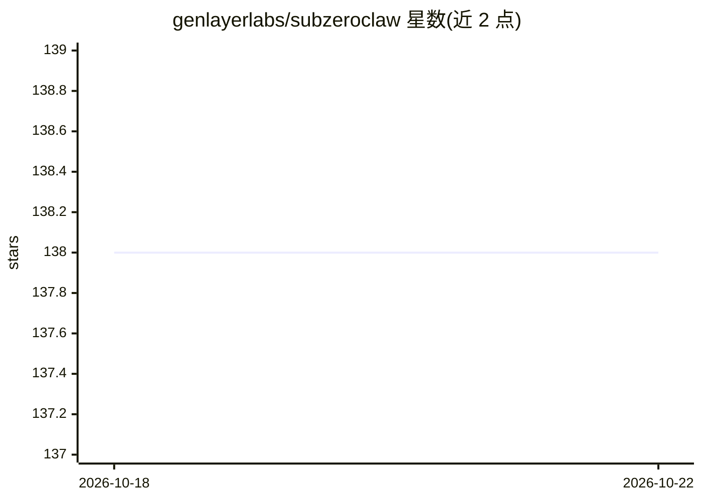

# genlayerlabs/subzeroclaw

⭐ 138 · C · MIT · 推送 2026-10-10 · [GitHub](https://github.com/genlayerlabs/subzeroclaw) · [官网](https://subzeroclaw.com) · 组织维护

**C 编写的极简 agentic 运行时，供开发者在边缘设备运行技能驱动 agent**

用约 550 行 C 实现的技能驱动 agent 运行时：读取 markdown 技能文件作为系统提示，调用 LLM，通过唯一的 shell 工具执行命令并循环直至任务完成。构建产物约 55KB、运行内存约 2MB，可在树莓派上 0.5 秒完成编译。路由、prompt-cache 亲和与上下文压缩委托给外部的 unhardcoded 路由器，也支持直连 OpenRouter 等裸 provider（降级模式）。README 明确警告无沙箱、无确认提示，LLM 输出直接执行任意 shell 命令。构建需要 gcc，运行依赖 curl。

## 筛选速览

| 维度 | 判定 | 备注 |
|---|---|---|
| AI 角色 | `ai-ecosystem` | LLM/agent 周边工具 |
| 许可风险 | `permissive` | MIT |
| 部署形态 | `None` |  |
| 模型依赖 | — | README 未给出锁定关系 |
| 硬件要求 | — | 无带数字的原话,不猜 |
| 安装摩擦 | `high` | 编译与系统依赖俱全 |
| 成熟度 | — | 结构信号不足 |

## 能力要点

- 约 55KB 二进制、约 2MB 运行内存，树莓派上 0.5 秒编译
- 技能即 markdown 文件，无格式规范与技能注册表
- 唯一工具为 shell，压缩与路由以 JSON 配置委托给 unhardcoded 路由器
- 读取配置后清除自身环境中的 provider 密钥，避免 shell 继承

## 适用场景

- 在树莓派等低资源设备上运行单技能自治 agent
- 用自己写的 markdown 技能文件驱动定时备份、监控等 shell 任务
- 需要一个无框架、可自托管的极简 agent 循环做二次开发

## 场景标签

`Agent 框架` · 领域:Agent 开发

## 证据(README 行号)

> L13: Every agentic runtime does the same thing: read a skill, call an LLM, execute tools, loop. SubZeroClaw is that prin
> L252: SubZeroClaw is an anti-framework. It does one thing: connect an LLM to a shell and loop. That's it. No plugin syst

## 星数曲线

2026-10-18 138 → 2026-10-22 138（+0）

---
*卡片 v1 · prompt 1.4 · 生成 2026-10-22 · 置信度 high · 依据 README sha `737130e976ac` · [字段定义](../../DATASET.md)*
