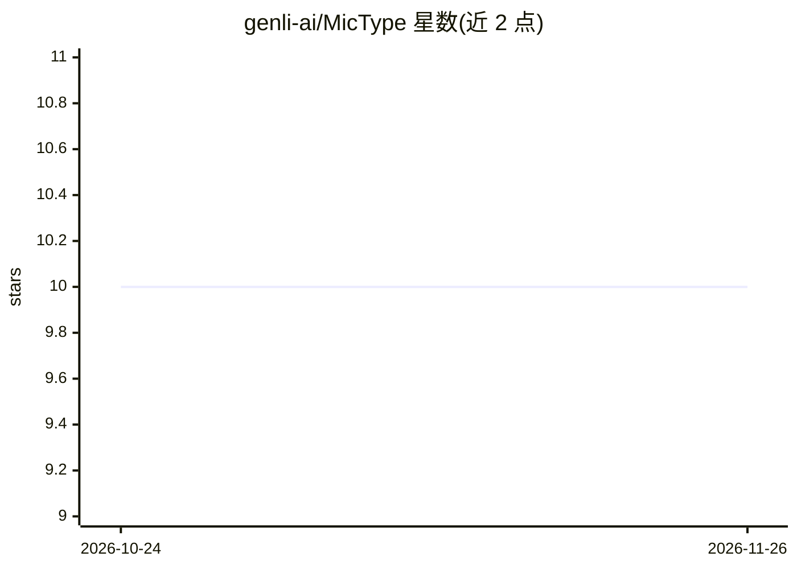

# genli-ai/MicType

⭐ 10 · Swift · MIT · 推送 2026-11-22 · [GitHub](https://github.com/genli-ai/MicType) · 组织维护 · 中文 README

**macOS 语音输入法：点按听写、按住下达 AI 指令**

一款 macOS（及 Windows beta）语音输入应用：右 Option 键点按进入听写，音频流式发送到 OpenAI 做实时与整段双重转写（可长达十分钟），取更准确的结果插入光标处；按住同一键则进入语音指令模式，由 AI 对选中文本改写、生成回复草稿、翻译或自由问答。自适应 AI 润色带防漂移兜底，支持自定义热词、历史按日存为纯文本。当前版本无本地识别，音频始终发送到 OpenAI，需粘贴 API key 才能工作。

## 筛选速览

| 维度 | 判定 | 备注 |
|---|---|---|
| AI 角色 | `ai-native` | 本体是模型或模型工具 |
| 许可风险 | `permissive` | MIT |
| 部署形态 | `desktop` | 安装包/桌面程序 |
| 模型依赖 | — | README 未给出锁定关系 |
| 硬件要求 | — | 无带数字的原话,不猜 |
| 安装摩擦 | `medium` | 含编译或系统依赖之一 |
| 成熟度 | — | 结构信号不足 |

## 能力要点

- 双重转写：实时流式 + 整段重发，取字符错误率更低的结果
- 按住即指令：无固定咒语，AI 从口述推断改写/回复/起草/翻译
- 自定义热词（wrong=right 同音字条目）同时作用于识别与润色
- 润色漂移兜底：数字/否定偏离时回插原始转写文本

## 适用场景

- 在任意应用中用语音替代键盘输入并自动加标点
- 选中文字后按住键口述改写或翻译要求
- 口述邮件回复并生成草稿到剪贴板
- 通过热词提升人名、品牌与术语的识别准确率

## 场景标签

`语音识别` `AI 写作` · 领域:内容生成

## 证据(README 行号)

> L3: **Voice input for macOS that doubles as your AI entry point.** One key, two gestures: **tap** the hotkey and your sp
> L34: - **Transcribed twice, the more accurate one wins** — audio streams to OpenAI's realtime recognizer (`gpt-live-tran
> L36: - **One provider, one key** — OpenAI: `gpt-live-transcribe` + `gpt-transcribe` for recognition, `gpt-5.6-terra` for

## 星数曲线

2026-10-24 10 → 2026-11-26 10（+0）

---
*卡片 v1 · prompt 1.4 · 生成 2026-11-19 · 置信度 high · 依据 README sha `d36eec379ca6` · [字段定义](../../DATASET.md)*
