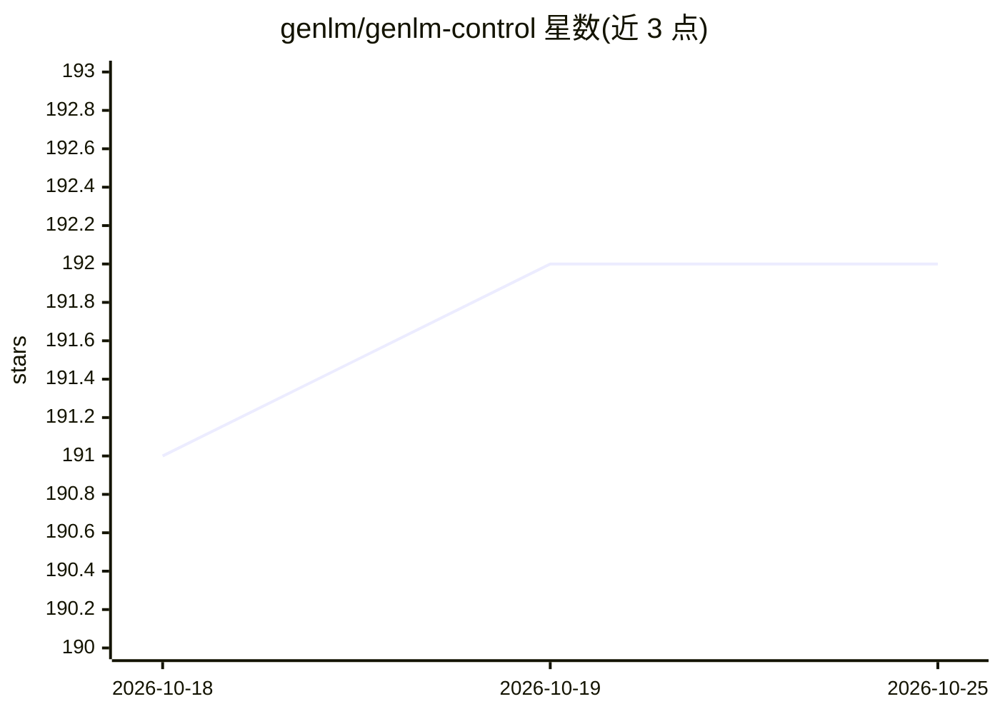

# genlm/genlm-control

⭐ 192 · Python · Apache-2.0 · 推送 2026-10-08 · [GitHub](https://github.com/genlm/genlm-control) · [官网](https://genlm.org/genlm-control/) · 组织维护

**用可编程约束控制 LLM 文本生成的 Python 库**

面向开发者的受控生成库：通过序贯蒙特卡洛（SMC）方法，使语言模型生成满足任意势函数编码的约束或偏好的文本。提供正则表达式约束（BoolFSA）、JSON Schema 约束等示例，支持 PromptedLLM 封装语言模型并配合 AWRS 等采样器。库基于异步编程，脚本中需用 asyncio.run 包装 SMC 调用。要求 Python>=3.11，经 pip 安装，开发安装另有说明文档。

## 筛选速览

| 维度 | 判定 | 备注 |
|---|---|---|
| AI 角色 | `ai-ecosystem` | LLM/agent 周边工具 |
| 许可风险 | `permissive` | Apache-2.0 |
| 部署形态 | `library` | 以包/库形式分发 |
| 模型依赖 | — | README 未给出锁定关系 |
| 硬件要求 | — | 无带数字的原话,不猜 |
| 安装摩擦 | `low` | 无编译、无系统依赖或容器化 |
| 成熟度 | — | 结构信号不足 |

## 能力要点

- SMC 序贯蒙特卡洛采样实现受约束生成
- 任意势函数编码约束或偏好
- 正则表达式与 JSON Schema 约束示例
- 基于 asyncio 的异步 API

## 适用场景

- 强制 LLM 输出匹配给定 JSON Schema 的结构化数据
- 用正则等语法约束控制 LLM 生成
- 在生成过程中施加自定义偏好函数

## 场景标签

 · 领域:LLM 基础设施/受控生成

## 证据(README 行号)

> L8: GenLM Control is a library for controlled generation from language models using programmable constraints. It leverag
> L32: ### Controlling an LLM with a regular expression

## 星数曲线

2026-10-18 191 → 2026-10-25 192（+1）

---
*卡片 v1 · prompt 1.4 · 生成 2026-10-23 · 置信度 high · 依据 README sha `86accf12d5fb` · [字段定义](../../DATASET.md)*
