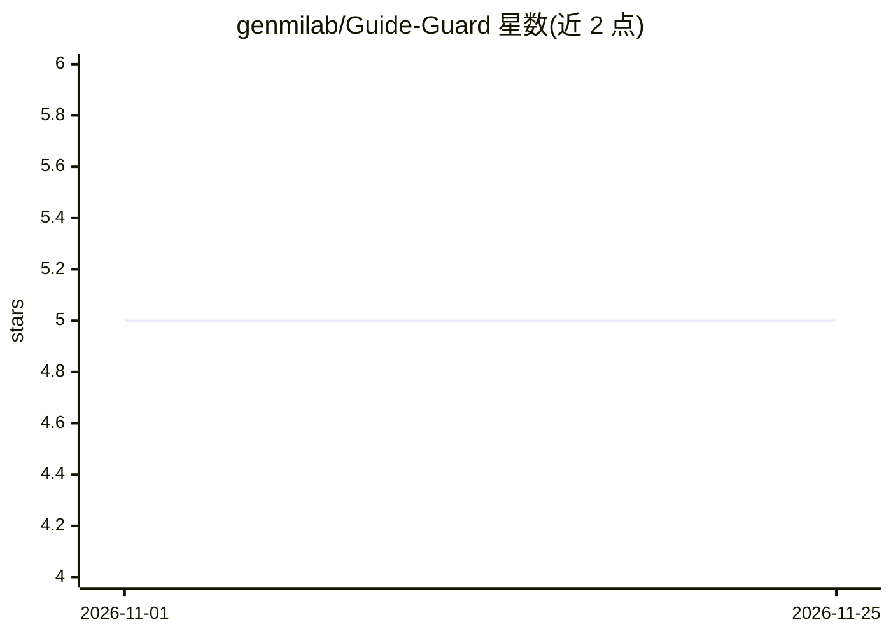

# genmilab/Guide-Guard

⭐ 5 · Python · Apache-2.0 · 推送 2026-10-31 · [GitHub](https://github.com/genmilab/Guide-Guard) · [官网](https://genmilab.github.io/Guide-Guard/) · 组织维护

**从非增强脑 MRI 合成 T1c 并用保形标记漏检增强区域**

Guide and Guard 是医学图像合成与不确定性量化的官方代码仓库：Guide 以病灶分割网络的 out-of-fold 图作为先验，用 2.5D 与 3D 两个回归合成器从 T1n/T2w/FLAIR 生成 T1c 图像；Guard 通过保形风险控制（CRC）与 Learn-then-Test 为任意合成器的输出标注 Supported/Check/Unlikely 三级体素图，控制增强肿瘤的漏检比例。基于 BraTS 2023 数据（876/126/249 患者级划分），需三个 Python 环境运行，权重通过 Hugging Face 分发。论文在审（IEEE ISBI 2027）。

## 筛选速览

| 维度 | 判定 | 备注 |
|---|---|---|
| AI 角色 | `ai-native` | 本体是模型或模型工具 |
| 许可风险 | `permissive` | Apache-2.0 |
| 部署形态 | `desktop` | 安装包/桌面程序 |
| 模型依赖 | — | README 未给出锁定关系 |
| 硬件要求 | — | 无带数字的原话,不猜 |
| 安装摩擦 | `low` | 无编译、无系统依赖或容器化 |
| 成熟度 | — | 结构信号不足 |

## 能力要点

- Guide：以 NC 分割器 lesion map 为输入通道的双合成器融合生成 T1c
- Guard：CRC 约束期望漏检，LTT 控制 Supported 级错误发现
- 兼容任意合成器，附 NC-only 无图像基线标记
- 提供推理脚本、图像质量评估与训练流程

## 适用场景

- 没有增强序列时为脑 MRI 病例生成虚拟 T1c
- 对合成图像标记可能被漏掉的增强肿瘤区域供复核
- 在 BraTS 布局数据上复现论文的合成与保形校准流程

## 场景标签

`图像生成` `目标检测` · 领域:内容生成

## 证据(README 行号)

> L30: - **Guide** synthesises post-contrast T1 (T1c) from non-contrast (NC) brain MRI (T1n, T2w, FLAIR). Out-of-fold lesi
> L31: - **Guard** attaches a three-level map (**Supported / Check / Unlikely**) to the T1c of *any* synthesiser. Conforma
> L43: 2. **Guide.** The maps are added as input channels to two regression synthesisers: a 2.5D YODA regressor and a 3D n

## 星数曲线

2026-11-01 5 → 2026-11-25 5（+0）

---
*卡片 v1 · prompt 1.4 · 生成 2026-11-21 · 置信度 high · 依据 README sha `7b6cecff92b4` · [字段定义](../../DATASET.md)*
