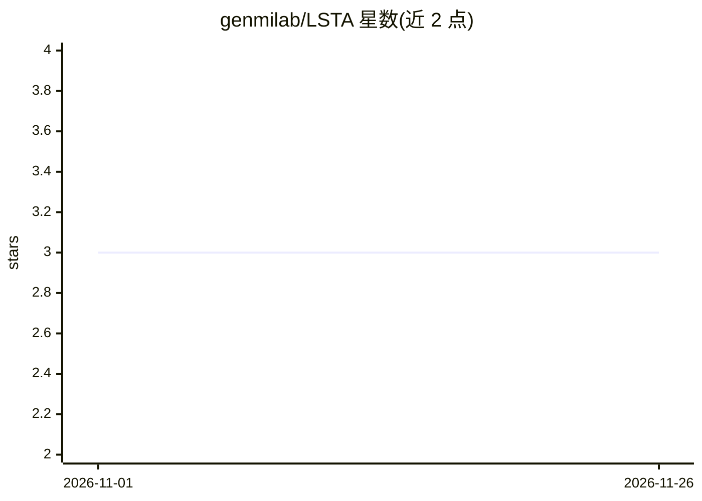

# genmilab/LSTA

⭐ 3 · Python · 推送 2026-10-31 · [GitHub](https://github.com/genmilab/LSTA) · [官网](https://adinathdukre.github.io/LSTA/) · 组织维护

**医学时序测试时自适应方法 LSTA 的官方研究代码**

LSTA（Learned Subspace Test-Time Adaptation）的官方实现：从历史受试者元学习一个低秩 LayerNorm 更新子空间，将新受试者的自适应限制在该子空间内，每名受试者最多使用八个无标注窗口完成个性化，用于 EEG/ECG 医学时序分类。仓库提供五个受试者级基准（ADFTD/APAVA/TDBRAIN/PTB/PTB-XL）的数据准备流程、基于 TeCh 预训练骨干的数据集脚本与结果汇总输出。声明仅供研究，未获临床使用批准。

## 筛选速览

| 维度 | 判定 | 备注 |
|---|---|---|
| AI 角色 | `ai-native` | 本体是模型或模型工具 |
| 许可风险 | `none` | — |
| 部署形态 | `library` | 以包/库形式分发 |
| 模型依赖 | — | README 未给出锁定关系 |
| 硬件要求 | — | 无带数字的原话,不猜 |
| 安装摩擦 | `medium` | 含编译或系统依赖之一 |
| 成熟度 | `idea` | |

## 能力要点

- 元学习低秩 LayerNorm 更新子空间，每受试者最多 8 个无标注窗口
- 覆盖 5 个 EEG/ECG 受试者级基准，脚本按数据集提供
- 训练记录、自适应基与评估结果自动保存汇总

## 适用场景

- 复现论文中的医学时序测试时自适应实验
- 在自有受试者数据上研究个性化分类
- 对比 TTA 基线在 EEG/ECG 基准上的表现

## 场景标签

`模型训练` · 领域:训练与推理

## 证据(README 行号)

> L28: Official code for **LSTA (Learned Subspace Test-Time Adaptation)**.
> L30: Test-time adaptation (TTA) promises to personalize medical time series classifiers to a new subject from a few unla
> L142: The code requires PyTorch 2.x. For GPU execution, install a PyTorch build compatible with your CUDA environment.

## 星数曲线

2026-11-01 3 → 2026-11-26 3（+0）

---
*卡片 v1 · prompt 1.4 · 生成 2026-11-22 · 置信度 high · 依据 README sha `078737a9a3bf` · [字段定义](../../DATASET.md)*
