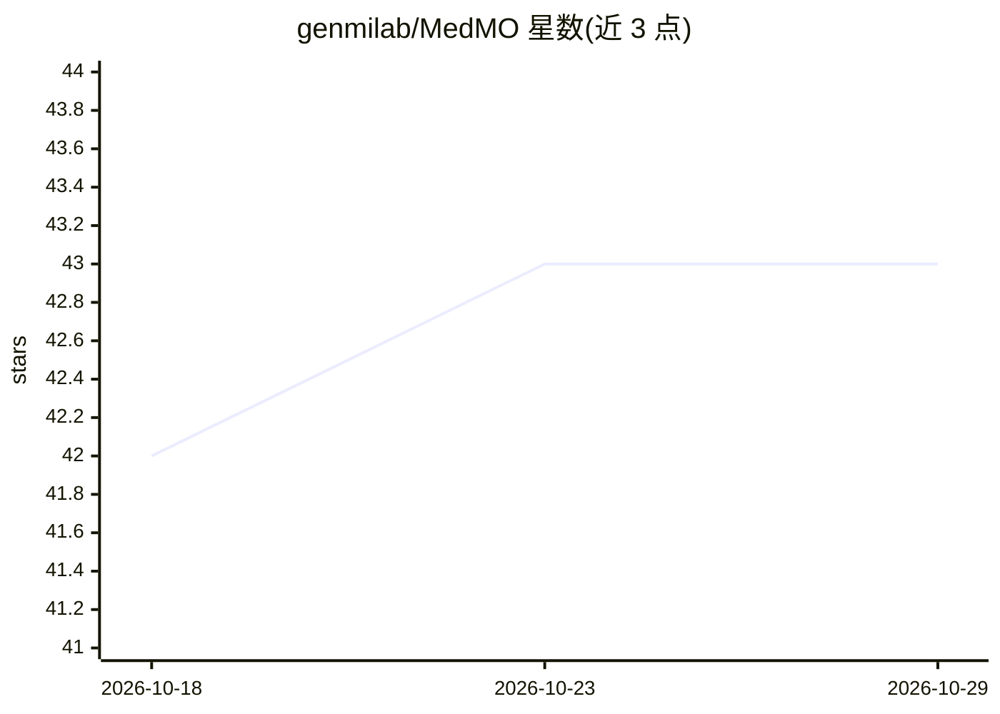

# genmilab/MedMO

⭐ 43 · Python · 推送 2026-04-08 · [GitHub](https://github.com/genmilab/MedMO) · [官网](https://genmilab.github.io/MedMO-Page) · 组织维护

**面向医学图像理解与定位的开源多模态基础模型**

MedMO 是基于 Qwen3-VL-8B-Instruct 训练的医学多模态大模型家族，提供 4B/8B 及 Next 版本共四个模型。在 45 个数据集的 26M+ 医学样本上经 4 阶段（SFT、高分辨率定位、指令微调、GRPO 强化学习）训练，支持医学 VQA、文本问答、放射报告生成、病灶边界框定位、解剖结构 grounding 与诊断分类等任务，覆盖放射、病理、眼科、皮肤、核医学等模态。通过 transformers 加载 HuggingFace 权重使用，Apache 2.0 许可。

## 筛选速览

| 维度 | 判定 | 备注 |
|---|---|---|
| AI 角色 | `ai-native` | 本体是模型或模型工具 |
| 许可风险 | `none` | — |
| 部署形态 | `library` | 以包/库形式分发 |
| 模型依赖 | — | README 未给出锁定关系 |
| 硬件要求 | — | 无带数字的原话,不猜 |
| 安装摩擦 | `low` | 无编译、无系统依赖或容器化 |
| 成熟度 | — | 结构信号不足 |

## 能力要点

- 4B/8B 参数量模型家族，基于 Qwen3-VL 训练
- 支持 VQA、报告生成、边界框疾病定位、解剖 grounding 等任务
- 26M+ 样本、45 数据集、4 阶段训练（含 GRPO 强化学习）
- 覆盖放射/病理/眼科/皮肤/核医学多模态

## 适用场景

- 对 X 光、CT、病理切片等医学影像做问答与诊断辅助
- 从医学影像生成放射报告
- 对病灶与解剖结构做边界框空间定位

## 场景标签

`多模态` · 领域:感知与多模态

## 证据(README 行号)

> L12: **MedMO-8B-Next** is the latest and most powerful iteration of the MedMO family — an open-source multimodal foundat
> L18: - **Visual Question Answering (VQA)**: Answer complex questions about medical images across radiology, pathology, o
> L20: - **Radiology Report Generation**: Generate detailed, clinically accurate radiology reports from medical images

## 星数曲线

2026-10-18 42 → 2026-10-29 43（+1）

---
*卡片 v1 · prompt 1.4 · 生成 2026-10-25 · 置信度 mid · 依据 README sha `533045683511` · [字段定义](../../DATASET.md)*
