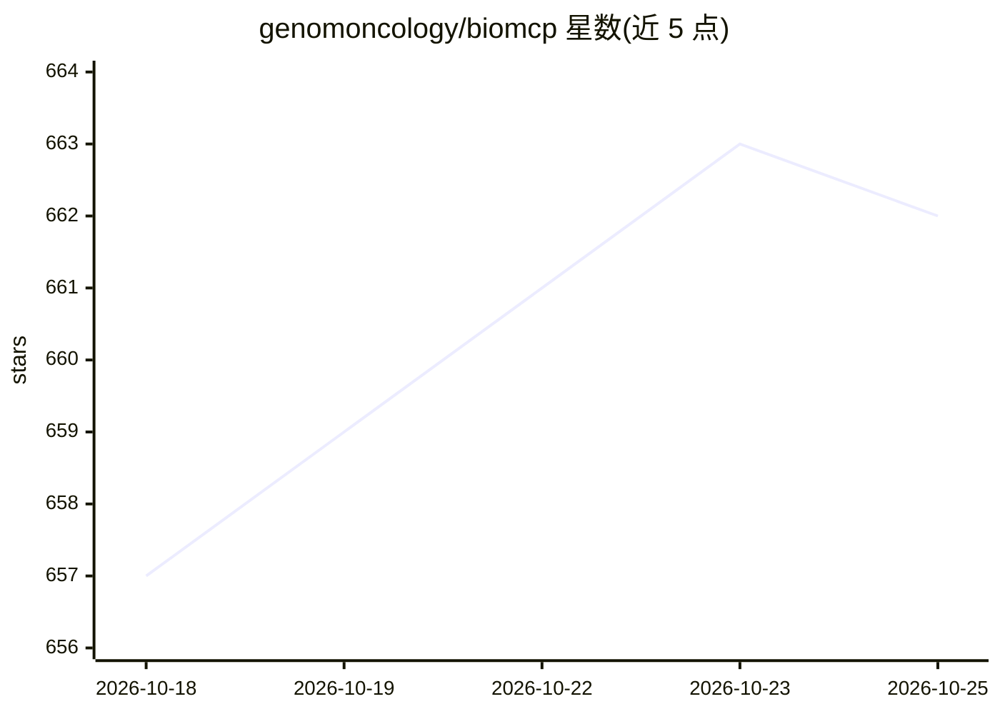

# genomoncology/biomcp

⭐ 662 · Rust · MIT · 推送 2026-10-24 · [GitHub](https://github.com/genomoncology/biomcp) · [官网](https://biomcp.org/) · 组织维护

**统一 CLI/MCP 服务器：直连 72 个生物医学数据源供研究者与 AI agent 查询**

BioMCP 提供单一 CLI 二进制与统一命令语法，直接访问 72 个生物医学上游数据源（PubMed、ClinVar、ClinicalTrials.gov、OncoKB、Reactome 等），并以 MCP 服务器形式（stdio/HTTP）把同一套工具暴露给 Claude Code、Codex、Claude Desktop 等 AI agent。支持跨实体检索与 pivot（基因/变异/药物/疾病/通路/文献等）、本地研究数据集分析与生存分析图表、基因集富集。多数命令无需 API key，可选 key 提升速率限制或解锁 OncoKB 等功能；各数据源使用条款需用户自行确认。

## 筛选速览

| 维度 | 判定 | 备注 |
|---|---|---|
| AI 角色 | `ai-ecosystem` | LLM/agent 周边工具 |
| 许可风险 | `permissive` | MIT |
| 部署形态 | `self-host` | docker 或自建部署 |
| 模型依赖 | — | README 未给出锁定关系 |
| 硬件要求 | — | 无带数字的原话,不猜 |
| 安装摩擦 | `low` | 无编译、无系统依赖或容器化 |
| 成熟度 | — | 结构信号不足 |

## 能力要点

- 统一命令语法覆盖 72 个生物医学数据源，跨实体检索与 pivot
- 同一 CLI 可作为 stdio/HTTP MCP 服务器供 AI agent 调用
- 本地研究数据集的 cohort、生存分析与终端/SVG/PNG 图表
- 文献检索在 PubTator3/Europe PMC/PubMed/Semantic Scholar 间联邦去重

## 适用场景

- 研究者用一条命令跨多个生物医学数据库检索基因、变异与文献
- 把生物医学数据查询能力接入 Claude Code/Codex 等 agent 工作流
- 对下载的 cBioPortal 风格数据集做本地生存与队列分析

## 场景标签

`科研工具` · 领域:学习与行业

## 证据(README 行号)

> L14: answer). It is also an MCP (Model Context Protocol) server, so the same tools are
> L15: available to AI agents such as Claude Code, Codex, and Claude Desktop.

## 星数曲线

2026-10-18 657 → 2026-10-25 662（+5）

---
*卡片 v1 · prompt 1.4 · 生成 2026-10-21 · 置信度 high · 依据 README sha `aab4a7bb87d4` · [字段定义](../../DATASET.md)*
