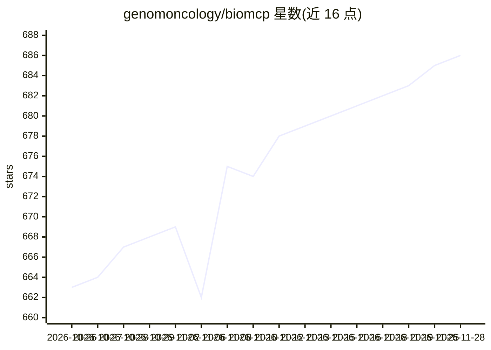

# genomoncology/biomcp

⭐ 686 · Rust · MIT · 推送 2026-11-10 · [GitHub](https://github.com/genomoncology/biomcp) · [官网](https://biomcp.org/) · 组织维护

**面向生物医学研究与 AI 代理的统一数据查询 CLI/MCP 服务器**

BioMCP 提供单一二进制与统一命令语法，直接访问 PubMed、ClinVar、ClinicalTrials.gov、OncoKB 等 72 个生物医学数据源；同时作为 MCP 服务器运行，把同一组工具暴露给 Claude Code、Codex、Claude Desktop 等 AI 代理。功能覆盖文献搜索、基因/变异/药物/试验/通路等实体查询、跨实体 pivot、g:Profiler 富集分析，以及本地 cBioPortal 风格数据集的队列与生存分析。大多数命令无需 API key，部分可选 key 改善限流或解锁补充数据；上游数据源的使用条款需用户自行核查。

## 筛选速览

| 维度 | 判定 | 备注 |
|---|---|---|
| AI 角色 | `ai-ecosystem` | LLM/agent 周边工具 |
| 许可风险 | `permissive` | MIT |
| 部署形态 | `self-host` | docker 或自建部署 |
| 模型依赖 | — | README 未给出锁定关系 |
| 硬件要求 | — | 无带数字的原话,不猜 |
| 安装摩擦 | `low` | 无编译、无系统依赖或容器化 |
| 成熟度 | — | 结构信号不足 |

## 能力要点

- 一个 CLI 二进制访问 72 个生物医学数据源的统一查询语法
- 同时作为 MCP 服务器供 Claude Code/Codex/Claude Desktop 等代理调用
- 支持本地 cBioPortal 风格数据集的队列、生存与共现分析
- 多数命令免 API key，可选 key 提升限流与解锁 OncoKB/DisGeNET 等数据

## 适用场景

- 用一条命令跨 PubMed/ClinVar/临床试验库检索 BRAF 相关证据
- 把生物医学数据工具接入 Claude Code 等 AI 代理工作流
- 本地分析下载的 cBioPortal 数据集并生成生存曲线
- 从基因/变异 pivot 到相关试验、文献与药物不良事件

## 场景标签

`科研工具` · 领域:学习与行业

## 证据(README 行号)

> L11: BioMCP is one CLI binary over a single command grammar that reaches 72 trusted
> L14: answer). It is also an MCP (Model Context Protocol) server, so the same tools are
> L15: available to AI agents such as Claude Code, Codex, and Claude Desktop.

## 星数曲线

2026-10-26 663 → 2026-11-28 686（+23）

---
*卡片 v1 · prompt 1.4 · 生成 2026-11-24 · 置信度 high · 依据 README sha `c16a7f5bbe36` · [字段定义](../../DATASET.md)*
