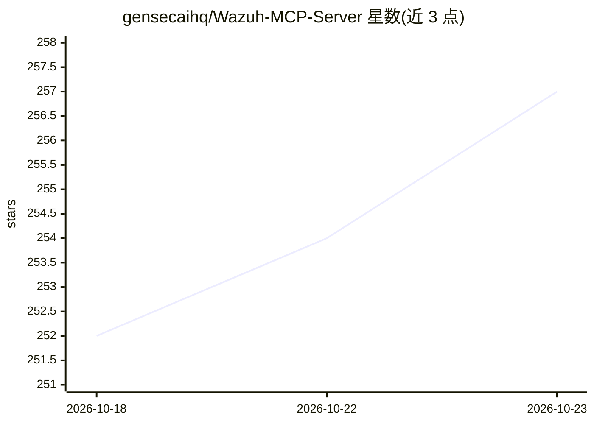

# gensecaihq/Wazuh-MCP-Server

⭐ 257 · Python · MIT · 推送 2026-10-16 · [GitHub](https://github.com/gensecaihq/Wazuh-MCP-Server) · [官网](https://wazuhmcp.netlify.app/) · 组织维护

**连接 LLM 客户端与 Wazuh SIEM 的 MCP 服务器**

面向 SOC 场景的 Model Context Protocol 服务器：让 Claude、Open WebUI 等客户端通过 Streamable HTTP 查询 Wazuh 的告警、代理、漏洞与合规数据，并下发主动响应（封禁 IP、隔离主机等）。提供 55 个工具（41 读 / 14 写，写操作需显式授权 scope），内置 OAuth 2.0/OIDC 认证、RBAC 与审计日志。服务器自身不调用模型，可搭配 vLLM + Open WebUI 本地部署。仅支持 Wazuh 4.8.0–4.14.7，合规类工具需 Wazuh Indexer。

## 筛选速览

| 维度 | 判定 | 备注 |
|---|---|---|
| AI 角色 | `ai-ecosystem` | LLM/agent 周边工具 |
| 许可风险 | `permissive` | MIT |
| 部署形态 | `self-host` | docker 或自建部署 |
| 模型依赖 | local-ok | 支持本地模型 |
| 硬件要求 | — | 无带数字的原话,不猜 |
| 安装摩擦 | `low` | 无编译、无系统依赖或容器化 |
| 成熟度 | — | 结构信号不足 |

## 能力要点

- 55 个工具覆盖告警分诊、威胁分析、合规检查与带验证/回滚的主动响应
- 默认只读，14 个状态变更工具需 wazuh:write scope
- OAuth 2.0+PKCE、OIDC 登录（Entra ID/Google/Okta/Keycloak）、JWT 令牌与作用域限制
- 提供 vLLM + Open WebUI 本地模型组合与工具集过滤

## 适用场景

- SOC 分析师用 Claude 等 AI 客户端分诊安全告警
- 通过对话触发 Wazuh 主动响应（封禁 IP、隔离主机）并验证回滚
- 本地模型环境下做 PCI-DSS/HIPAA/GDPR 等合规检查

## 场景标签

`网络安全` · 领域:学习与行业

## 证据(README 行号)

> L5: Lets an MCP client — Claude, Open WebUI backed by a local model, or any client that speaks Streamable HTTP — query a
> L21: - **55 tools** in 8 toolsets: alerts, agents, vulnerabilities, threat analysis, compliance (PCI-DSS, HIPAA, SOX, GD
> L112: The server does not call a model; it only executes tools. To keep SIEM data on-premises, pair it with a local mode

## 星数曲线

2026-10-18 252 → 2026-10-23 257（+5）

---
*卡片 v1 · prompt 1.4 · 生成 2026-10-22 · 置信度 mid · 依据 README sha `deab85c4bf21` · [字段定义](../../DATASET.md)*
