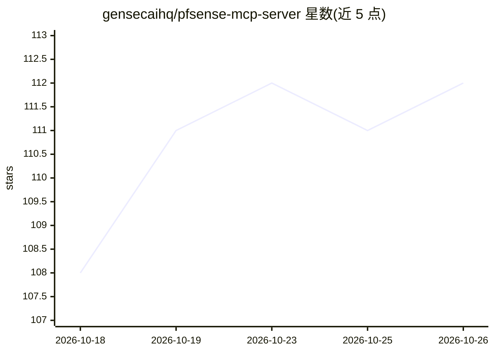

# gensecaihq/pfsense-mcp-server

⭐ 112 · Python · MIT · 推送 2026-10-09 · [GitHub](https://github.com/gensecaihq/pfsense-mcp-server) · 组织维护

**通过自然语言管理 pfSense 防火墙的 MCP 服务器（332 工具）**

面向 Claude Desktop、Claude Code 及任意 MCP 客户端的 pfSense 防火墙管理服务器：将 332 个工具（描述称 333）接入 pfSense REST API v2.10.2，覆盖防火墙规则、VPN、DNS、DHCP、NAT、证书、路由、日志与诊断等子系统。提供 9 层安全护栏：高危操作需 confirm=True、201 个变更工具全部带护栏与限流、变更前记录可回滚的配置修订、dry_run 预览、只读模式与工具白名单。支持 stdio/HTTP/Docker 三种部署，Basic/API Key/JWT 三种认证；未发布到 PyPI，需从 Git 或 release 资产安装。

## 筛选速览

| 维度 | 判定 | 备注 |
|---|---|---|
| AI 角色 | `ai-ecosystem` | LLM/agent 周边工具 |
| 许可风险 | `permissive` | MIT |
| 部署形态 | `self-host` | docker 或自建部署 |
| 模型依赖 | — | README 未给出锁定关系 |
| 硬件要求 | — | 无带数字的原话,不猜 |
| 安装摩擦 | `low` | 无编译、无系统依赖或容器化 |
| 成熟度 | — | 结构信号不足 |

## 能力要点

- 332 个工具覆盖 pfSense 全部主要子系统，wire-format 对照 REST API 架构验证
- 9 层安全护栏：高危操作 confirm、限流、审计日志、敏感信息脱敏
- MCP_READ_ONLY 只读模式与 MCP_ALLOWED_TOOLS 白名单
- stdio/HTTP（bearer token）与加固 Docker 容器三种部署方式

## 适用场景

- 在 Claude Desktop 中用自然语言查看和修改防火墙规则、VPN 与 DNS 配置
- 通过对话诊断 pfSense 连通性、阻塞流量与系统健康
- 以只读模式让 AI 查询防火墙状态而不允许变更

## 场景标签

`网络安全` · 领域:学习与行业

## 证据(README 行号)

> L23: **pfSense MCP Server** connects Claude Desktop, Claude Code, and any other MCP client to your pfSense firewall. Ask
> L5: **332 tools** across every subsystem · **wire-format verified** against the pfSense REST API · **safety guardrails**

## 星数曲线

2026-10-18 108 → 2026-10-26 112（+4）

---
*卡片 v1 · prompt 1.4 · 生成 2026-10-23 · 置信度 mid · 依据 README sha `15539fa70b2c` · [字段定义](../../DATASET.md)*
