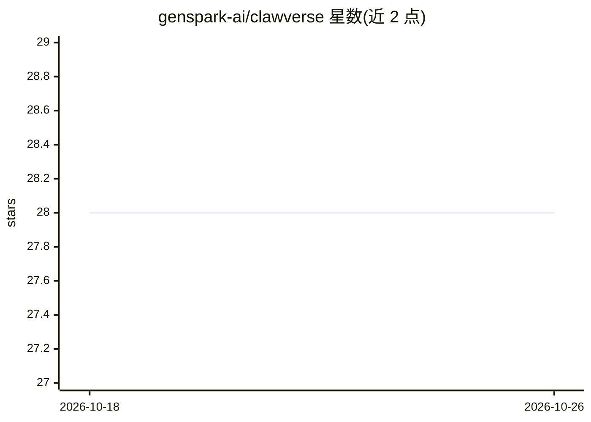

# genspark-ai/clawverse

⭐ 28 · HTML · MIT · 推送 2026-03-25 · [GitHub](https://github.com/genspark-ai/clawverse) · [官网](https://genclawverse.ai) · 组织维护

**像素风等距小岛建造社交游戏，含 AI 布局与 AI 生成贴图**

Flask + SQLite + 原生 JS 等距渲染器实现的持久化像素小岛建造游戏：32×32 网格、50+ 地形与物件贴图、快照、主题、XP/成就、访客社交（留言、礼物、实时 SSE 在场显示）。AI 部分：文字描述匹配 6 种预设的布局助手，以及调用 gsk 按描述生成像素贴图。全部代码由 Genspark AI 自动生成（README 声称零人写代码）。属主在本机有编辑权，外部访客只读加社交操作。

## 筛选速览

| 维度 | 判定 | 备注 |
|---|---|---|
| AI 角色 | `ai-enhanced` | 去掉 AI 部分产品仍成立 |
| 许可风险 | `permissive` | MIT |
| 部署形态 | `None` |  |
| 模型依赖 | — | README 未给出锁定关系 |
| 硬件要求 | — | 无带数字的原话,不猜 |
| 安装摩擦 | `low` | 无编译、无系统依赖或容器化 |
| 成熟度 | — | 结构信号不足 |

## 能力要点

- 文字描述生成岛屿布局（6 种预设 + 关键词匹配）
- gsk 按描述生成像素贴图
- 访客社交系统：留言、每日礼物、emoji 印记、SSE 实时在场
- 快照/主题/XP/成就等建造进度机制

## 适用场景

- 搭建并分享自己的像素风小岛给朋友访问
- 让 AI 按文字描述生成布局或贴图
- 作为访客浏览他人岛屿并留言送礼

## 场景标签

`图像生成` · 领域:内容生成

## 证据(README 行号)

> L34: - 🤖 **AI Layout Assistant** — Describe your vision, AI builds it
> L37: - ✨ **AI Tile Generation** — Describe any tile, gsk generates pixel art

## 星数曲线

2026-10-18 28 → 2026-10-26 28（+0）

---
*卡片 v1 · prompt 1.4 · 生成 2026-10-26 · 置信度 high · 依据 README sha `121dd79c6fea` · [字段定义](../../DATASET.md)*
