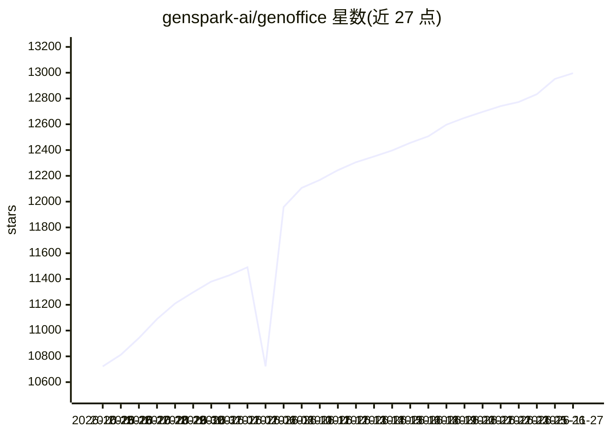

# genspark-ai/genoffice

⭐ 12,996 · TypeScript · Apache-2.0 · 推送 2026-11-26 · [GitHub](https://github.com/genspark-ai/genoffice) · [官网](https://genoffice.ai/) · 组织维护 · 中文 README

**开源 AI 办公套件：本地编辑 Office 文件并内置 AI agent**

GenOffice 是面向 macOS/Windows/Linux 的开源办公套件，包含文档、表格、幻灯片、PDF、Markdown、HTML 六个编辑器，可直接打开并保存原生 .docx/.xlsx/.pptx，支持 ODF 与旧版格式的导入（保存统一为 OOXML）。AI 部分以旁挂面板形式存在：读取文件、以修订/diff 形式落笔、可一键回滚，支持对选区或单元格范围对模型隐藏；提供 genoffice CLI 与 agent skill，供编码 agent 在本地创建与编辑 Office 文件；模型调用通过自带 API key 或 Genspark 登录完成。

## 筛选速览

| 维度 | 判定 | 备注 |
|---|---|---|
| AI 角色 | `ai-enhanced` | 去掉 AI 部分产品仍成立 |
| 许可风险 | `permissive` | Apache-2.0 |
| 部署形态 | `desktop` | 安装包/桌面程序 |
| 模型依赖 | locked-api |  |
| 硬件要求 | — | 无带数字的原话,不猜 |
| 安装摩擦 | `low` | 无编译、无系统依赖或容器化 |
| 成熟度 | — | 结构信号不足 |

## 能力要点

- 打开并按字节保留保存原生 .docx/.xlsx/.pptx，兼容 ODF/旧版 Office/Hancom 格式导入
- AI 编辑以修订与 diff 呈现，支持快照回滚与选区对模型隐藏
- PDF→Word/Excel/PowerPoint 转换在本机完成
- genoffice CLI 与 agent skill 供 Claude Code、Codex、Cursor 等调用

## 适用场景

- 在本地用 AI 批量生成或改写 Word/Excel/PPT 文件
- 对 PDF 做原位文字编辑并转换为可编辑文档
- 用编码 agent 直接读写本机 Office 文件

## 场景标签

`AI 写作` `文档解析` · 领域:内容生成

## 证据(README 行号)

> L29: GenOffice is a free, open-source alternative to Microsoft Office for macOS,
> L31: files, edits PDF, Markdown and HTML, and puts an AI agent next to every
> L60: - **Your keys or none.** Sign in with Genspark and skip keys, or bring your own

## 星数曲线

2026-10-25 10,722 → 2026-11-27 12,996（+2,274）

---
*卡片 v1 · prompt 1.4 · 生成 2026-11-23 · 置信度 mid · 依据 README sha `8fa502d76cd7` · [字段定义](../../DATASET.md)*
