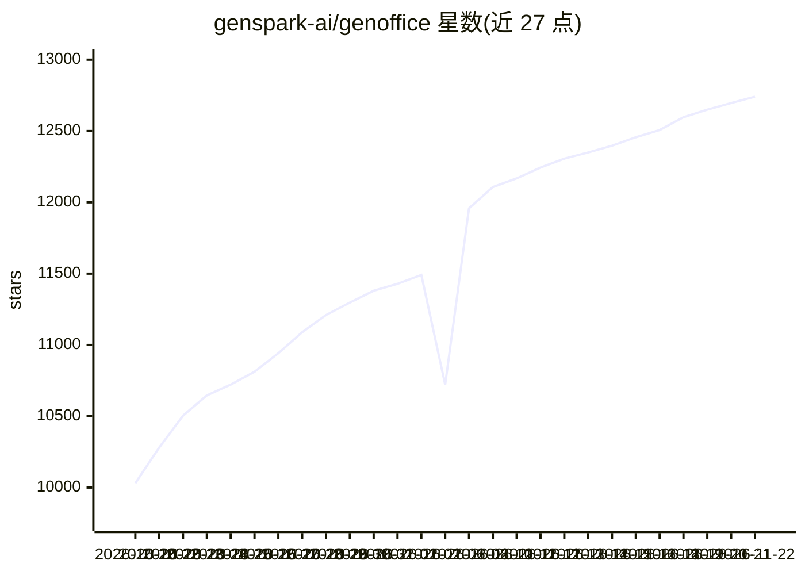

# genspark-ai/genoffice

⭐ 12,741 · TypeScript · Apache-2.0 · 推送 2026-11-20 · [GitHub](https://github.com/genspark-ai/genoffice) · [官网](https://genoffice.ai/) · 组织维护

**开源 AI 办公套件：编辑 Office/PDF/MD 文件并内置 AI 面板**

GenOffice 是跨平台（macOS/Windows/Linux）桌面办公套件，含文档、表格、幻灯片、PDF、Markdown、HTML 六个编辑器，打开并保存原生 .docx/.xlsx/.pptx，未编辑部分按字节保留。每个文档旁内置 AI agent：编辑以修订与 diff 呈现，可一键回滚，可隐藏单元格或选区不让模型读取。文件在本机打开、编辑、保存与转换，仅 AI 调用外发到用户自选的提供方；支持自带 API key 或登录 Genspark。另附 genoffice CLI 与 agent skill，供编码类 agent 在本机创建和编辑 Office 文件。

## 筛选速览

| 维度 | 判定 | 备注 |
|---|---|---|
| AI 角色 | `ai-enhanced` | 去掉 AI 部分产品仍成立 |
| 许可风险 | `permissive` | Apache-2.0 |
| 部署形态 | `desktop` | 安装包/桌面程序 |
| 模型依赖 | — | README 未给出锁定关系 |
| 硬件要求 | — | 无带数字的原话,不猜 |
| 安装摩擦 | `low` | 无编译、无系统依赖或容器化 |
| 成熟度 | `idea` | |

## 能力要点

- 六合一编辑器，打开/保存原生 OOXML 格式，未编辑部分字节保留
- AI 编辑以修订/diff 落盘，支持快照回滚与内容隐藏（占位符保护）
- 本地 SQLite 全文索引检索文件，CJK 分词，可用 TypeSafe Jev 重排
- 提供 genoffice CLI 与 agent skill，供 Claude Code 等编码 agent 调用

## 适用场景

- 在本机编辑并保留 Word/Excel/PowerPoint 原格式的文件
- 从一句话生成 .pptx 演示文稿或单文件 HTML 页面
- 让编码 agent 在本机创建和转换 Office 文件
- 跨多个文档提问并查看逐条来源引用

## 场景标签

`编码 Agent` `文档问答` · 领域:编码与开发

## 证据(README 行号)

> L29: GenOffice is a free, open-source alternative to Microsoft Office for macOS,
> L31: files, edits PDF, Markdown and HTML, and puts an AI agent next to every
> L64: - **Scriptable and agent-ready.** The app ships a `genoffice` command line and

## 星数曲线

2026-10-20 10,031 → 2026-11-22 12,741（+2,710）

---
*卡片 v1 · prompt 1.4 · 生成 2026-11-22 · 置信度 high · 依据 README sha `9fe226b78c15` · [字段定义](../../DATASET.md)*
