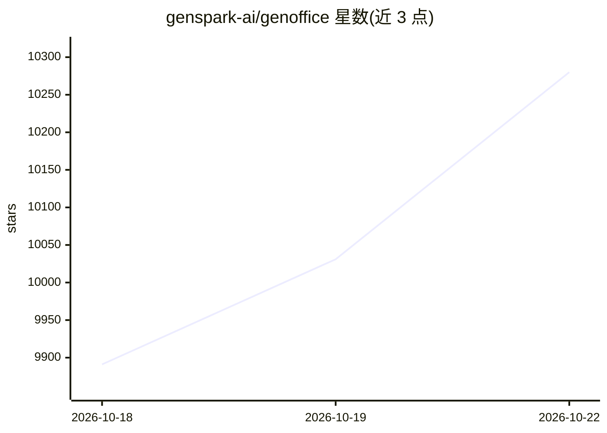

# genspark-ai/genoffice

⭐ 10,280 · TypeScript · Apache-2.0 · 推送 2026-10-21 · [GitHub](https://github.com/genspark-ai/genoffice) · [官网](https://genoffice.ai/) · 组织维护 · 中文 README

**开源 AI 办公套件：本地编辑 Office/PDF/Markdown/HTML 并带 AI 代理**

面向 macOS/Windows/Linux 用户的开源办公套件，提供 Docs、Sheets、Slides、PDF、HTML、Markdown 编辑器，原生打开并保存 .docx/.xlsx/.pptx，未编辑部分按字节保留。内置 AI 面板可代为编辑文档、生成幻灯片与网页，编辑以修订/快照形式可回滚；文件在本地打开编辑转换，仅 AI 调用外发。支持自带 API key（Claude/OpenAI/Gemini/DeepSeek 等）或 Genspark 登录。附 genoffice CLI 与 agent skill，供 Claude Code、Codex、Cursor 等编码代理本地读写 Office 文件。

## 筛选速览

| 维度 | 判定 | 备注 |
|---|---|---|
| AI 角色 | `ai-enhanced` | 去掉 AI 部分产品仍成立 |
| 许可风险 | `permissive` | Apache-2.0 |
| 部署形态 | `desktop` | 安装包/桌面程序 |
| 模型依赖 | locked-api |  |
| 硬件要求 | — | 无带数字的原话,不猜 |
| 安装摩擦 | `low` | 无编译、无系统依赖或容器化 |
| 成熟度 | — | 结构信号不足 |

## 能力要点

- 原生读写 .docx/.xlsx/.pptx，未编辑内容按字节保留
- AI 编辑以修订与快照呈现，支持一键回滚
- 本地 SQLite 全文索引（含 CJK）搜索文件，可选 Jev 重排
- 附 genoffice CLI 与 agent skill，供编码代理读写 Office 文件

## 适用场景

- 本地打开和编辑 Word/Excel/PowerPoint 文件
- 让 AI 按提示生成幻灯片、网页并保留可编辑格式
- 在选定的文档集合上做带出处的跨文档问答

## 场景标签

`文档问答` `AI 写作` · 领域:内容生成

## 证据(README 行号)

> L28: GenOffice is a free, open-source alternative to Microsoft Office for macOS,
> L30: files, edits PDF, Markdown and HTML, and puts an AI agent next to every
> L40: - **Local by design.** Files open, edit, save and convert on your machine.

## 星数曲线

2026-10-18 9,891 → 2026-10-22 10,280（+389）

---
*卡片 v1 · prompt 1.4 · 生成 2026-10-20 · 置信度 mid · 依据 README sha `b9ec1f05d1fb` · [字段定义](../../DATASET.md)*
