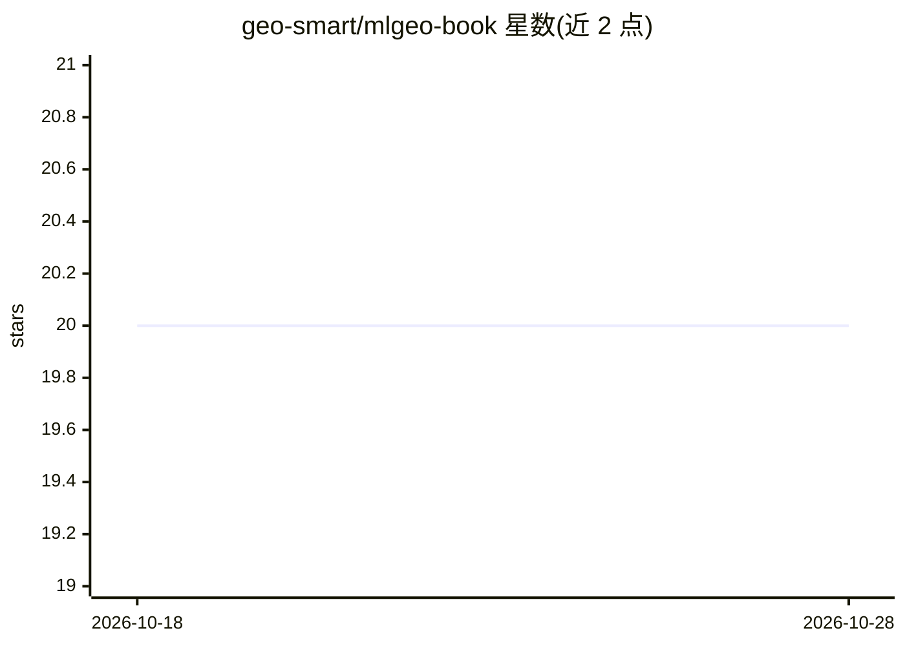

# geo-smart/mlgeo-book

⭐ 20 · Jupyter Notebook · MIT · 推送 2026-10-26 · [GitHub](https://github.com/geo-smart/mlgeo-book) · [官网](https://geo-smart.github.io/mlgeo-book/) · 组织维护

**地球科学机器学习课程教材（UW ESS 469/569），2026 版**

华盛顿大学 ESS 469/569 课程的 Jupyter Book 教材，讲授地球科学中的机器学习，数据集以美国及太平洋西北地区为主。全课程代码运行于单一 pixi 环境，锁定 macOS（Apple silicon）与 Linux 版本，Windows 需 WSL2 或 Codespace；提供英/法/西三语版本。教材 CC BY 4.0、代码 MIT，可 fork 改编；通过 12+13 个虚构读者 persona 驱动 AI 审阅代理发现内容缺口，习题解答以折叠单元格形式随书发布。用 Jupyter Book 2 / MyST 构建。

## 筛选速览

| 维度 | 判定 | 备注 |
|---|---|---|
| AI 角色 | `ai-knowledge` | 知识聚合/清单类 |
| 许可风险 | `permissive` | MIT |
| 部署形态 | `library` | 以包/库形式分发 |
| 模型依赖 | — | README 未给出锁定关系 |
| 硬件要求 | — | 无带数字的原话,不猜 |
| 安装摩擦 | `low` | 无编译、无系统依赖或容器化 |
| 成熟度 | `idea` | |

## 能力要点

- 单一 pixi 环境锁定全部课程依赖（含 torch/sklearn/obspy）
- 英/法/西三语版本，法语西语版本地化但沿用英文版数据
- persona 驱动的 AI 审阅代理用于教材改编缺口发现
- 习题解答以折叠 admonition 形式内嵌于发布书籍

## 适用场景

- 我想学习地学中的机器学习方法并动手跑笔记本
- 作为教师 fork 并改编成面向本地区数据的课程
- 在 VS Code 或 JupyterLab 中复现课程环境

## 场景标签

`教程课程` · 领域:学习与行业

## 证据(README 行号)

> L21: This material was developed for ESS 469/569 at the University of Washington,
> L155: This repository is the single source of truth for the MLGeo curriculum book (2026 edition). It is edited directly:

## 星数曲线

2026-10-18 20 → 2026-10-28 20（+0）

---
*卡片 v1 · prompt 1.4 · 生成 2026-10-28 · 置信度 mid · 依据 README sha `8e7d2a8a9a18` · [字段定义](../../DATASET.md)*
