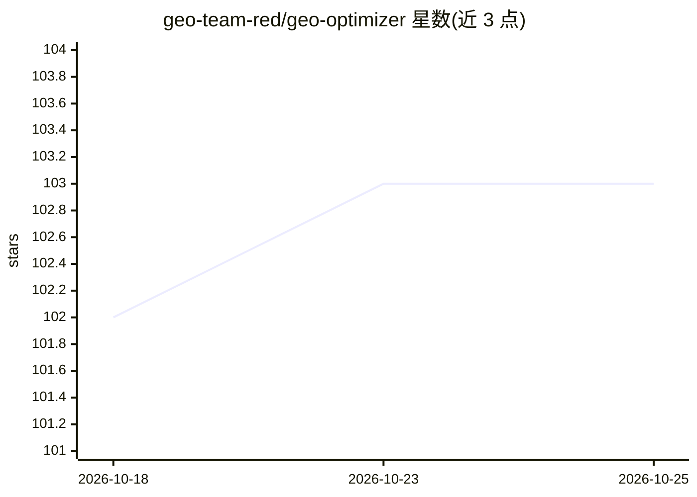

# geo-team-red/geo-optimizer

⭐ 103 · Go · MIT · 推送 2026-03-27 · [GitHub](https://github.com/geo-team-red/geo-optimizer) · 组织维护

**Go 编写的可插拔 GEO（生成式引擎优化）内容优化框架**

面向开发者的 Go 框架，用于对内容做 GEO（Generative Engine Optimization）优化：内置 Structure、Schema、AnswerFirst、Authority、FAQ 五种策略，可组合使用，也可实现 Strategy 接口注册自定义策略。提供 LLM 抽象层（当前支持 GLM，可扩展到其他 provider）、规则式 GEO 质量评分、JSON-LD 结构化数据生成，以及 ChatGPT/Perplexity/Google AI/Claude 的平台预设。宣称支持多租户隔离。要求 Go 1.21+ 与 LLM API 访问，附带 E2E 测试 CLI。

## 筛选速览

| 维度 | 判定 | 备注 |
|---|---|---|
| AI 角色 | `ai-ecosystem` | LLM/agent 周边工具 |
| 许可风险 | `permissive` | MIT |
| 部署形态 | `None` |  |
| 模型依赖 | — | README 未给出锁定关系 |
| 硬件要求 | — | 无带数字的原话,不猜 |
| 安装摩擦 | `low` | 无编译、无系统依赖或容器化 |
| 成熟度 | — | 结构信号不足 |

## 能力要点

- 5 种内置优化策略，可组合、可注册自定义 Strategy 实现
- LLM 抽象层，当前支持 GLM，接口可扩展至其他 provider
- 规则式 GEO 内容质量评分与 JSON-LD 结构化数据生成
- ChatGPT/Perplexity/Google AI/Claude 四种 AI 平台预设

## 适用场景

- 优化网页或文档内容以提升其在生成式引擎中的可见性
- 为自己的内容管线集成 GEO 优化策略并自定义扩展
- 对内容做规则式 GEO 质量评分与结构化标记生成

## 场景标签

`AI 写作` · 领域:内容生成

## 证据(README 行号)

> L8: A **pluggable framework** for GEO (Generative Engine Optimization) in Go. Built-in strategies for common use cases, 
> L19: - **LLM Abstraction**: Clean interface supporting multiple LLM providers (GLM, extensible to others)

## 星数曲线

2026-10-18 102 → 2026-10-25 103（+1）

---
*卡片 v1 · prompt 1.4 · 生成 2026-10-23 · 置信度 high · 依据 README sha `9b3e2fa8c095` · [字段定义](../../DATASET.md)*
