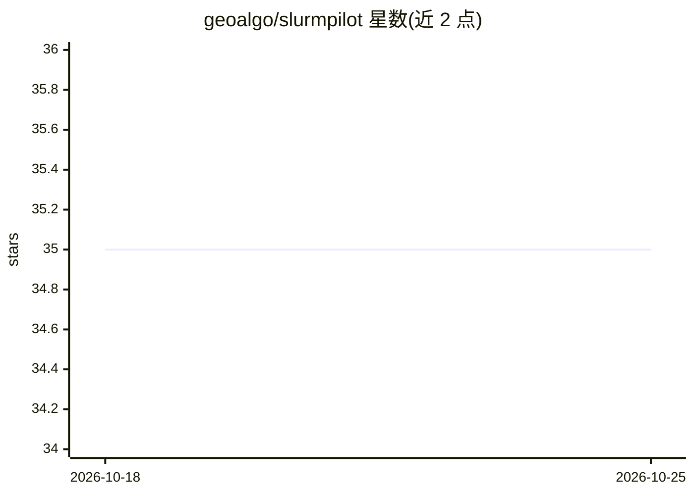

# geoalgo/slurmpilot

⭐ 35 · Python · 推送 2026-06-29 · [GitHub](https://github.com/geoalgo/slurmpilot) · 个人维护

**从本地机器向 Slurm 集群提交并管理实验的 Python 库**

面向学术研究环境的 Python 库与 CLI：通过 SSH 从笔记本向多个 Slurm 集群同步源代码文件、生成 sbatch 脚本、提交作业并跟踪状态；也可在登录节点本地模式直接调用 sbatch，或用 mock 模式无 Slurm 环境测试。支持作业数组做参数扫描、自动生成元数据、CLI 查看日志/队列位置/取消作业。运行时仅依赖 pyyaml 和 coolname，不要求 Docker，直接发送源文件。

## 筛选速览

| 维度 | 判定 | 备注 |
|---|---|---|
| AI 角色 | `ai-ecosystem` | LLM/agent 周边工具 |
| 许可风险 | `permissive` | — |
| 部署形态 | `library` | 以包/库形式分发 |
| 模型依赖 | — | README 未给出锁定关系 |
| 硬件要求 | — | 无带数字的原话,不猜 |
| 安装摩擦 | `low` | 无编译、无系统依赖或容器化 |
| 成熟度 | — | 结构信号不足 |

## 能力要点

- SSH 同步源文件并远程调用 sbatch，支持多集群统一管理
- local（登录节点直跑）与 mock（无 Slurm 模拟）两种运行模式
- 作业数组参数扫描，列表即一个数组任务
- CLI（sp launch/log/status/queue-status 等）管理作业

## 适用场景

- 从笔记本向多个 Slurm 集群提交并跟踪实验作业
- 用作业数组批量跑超参数扫描
- 无 Docker 权限的学术集群上同步源代码运行实验

## 场景标签

`MLOps` · 领域:训练与推理

## 证据(README 行号)

> L8: **Slurmpilot** is a Python library designed to simplify launching experiments on Slurm clusters directly from your l
> L12: Slurmpilot is designed for academic research environments: multi-cluster support, no Docker requirement, source fil

## 星数曲线

2026-10-18 35 → 2026-10-25 35（+0）

---
*卡片 v1 · prompt 1.4 · 生成 2026-10-25 · 置信度 mid · 依据 README sha `7eb8c09a6aab` · [字段定义](../../DATASET.md)*
