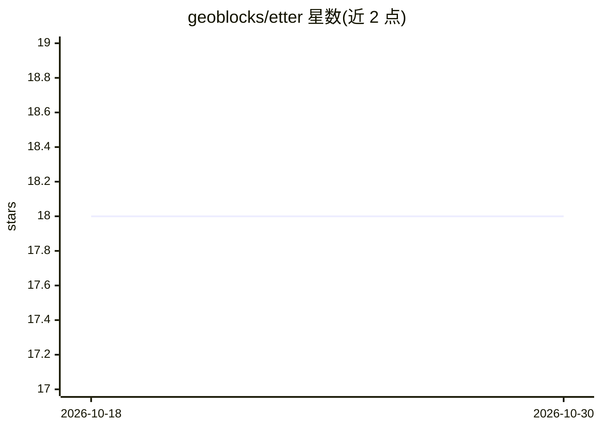

# geoblocks/etter

⭐ 18 · Python · BSD-3-Clause · 推送 2026-10-28 · [GitHub](https://github.com/geoblocks/etter) · [官网](https://geoblocks.github.io/etter/) · 组织维护

**用 LLM 把自然语言位置查询解析为结构化地理过滤器**

Python 库 etter（geoblocks 维护，Camptocamp 赞助）：借助 LLM 解析多语言（英/德/法/意等）自然语言位置查询，提取空间关系（包含、缓冲、方向、裁剪等）、参照位置与距离参数，输出 Pydantic 结构化的 GeoQuery 地理过滤器，供搜索引擎与空间数据库使用。不处理特征/活动识别、属性过滤与搜索执行，由父应用组合完成。支持 OpenAI、Anthropic 或本地模型，提供流式输出、可配置空间关系与置信度阈值，以及 PostGIS 数据源可选安装。

## 筛选速览

| 维度 | 判定 | 备注 |
|---|---|---|
| AI 角色 | `ai-ecosystem` | LLM/agent 周边工具 |
| 许可风险 | `permissive` | BSD-3-Clause |
| 部署形态 | `library` | 以包/库形式分发 |
| 模型依赖 | — | README 未给出锁定关系 |
| 硬件要求 | — | 无带数字的原话,不猜 |
| 安装摩擦 | `low` | 无编译、无系统依赖或容器化 |
| 成熟度 | — | 结构信号不足 |

## 能力要点

- 从查询中提取空间关系/参照位置/距离参数并输出 Pydantic 结构化模型
- 支持包含、缓冲（near/on_shores_of/bordering 等）、方向（8 方位扇区）、裁剪等空间关系
- LLM Provider 无关：OpenAI、Anthropic 或本地模型均可
- 支持流式解析、批量解析与自定义输出 schema 嵌套

## 适用场景

- 在地理搜索应用中把'洛桑以北 5km'类查询转为可执行的空间过滤条件
- 多语言地图/地点搜索产品解析用户位置意图
- 结合自家 schema 在单次 LLM 调用中同时抽取地理与业务字段

## 场景标签

 · 领域:地理空间/NLP 工具库

## 证据(README 行号)

> L9: etter transforms natural language location queries into structured geographic filters that can be used by search eng
> L12: **Key Principle:** etter's sole purpose is to extract the **geographic filter** from user queries. It does NOT hand
> L31: - **LLM Provider Agnostic**: Works with OpenAI, Anthropic, or local models

## 星数曲线

2026-10-18 18 → 2026-10-30 18（+0）

---
*卡片 v1 · prompt 1.4 · 生成 2026-10-29 · 置信度 high · 依据 README sha `dacb6c258a0e` · [字段定义](../../DATASET.md)*
