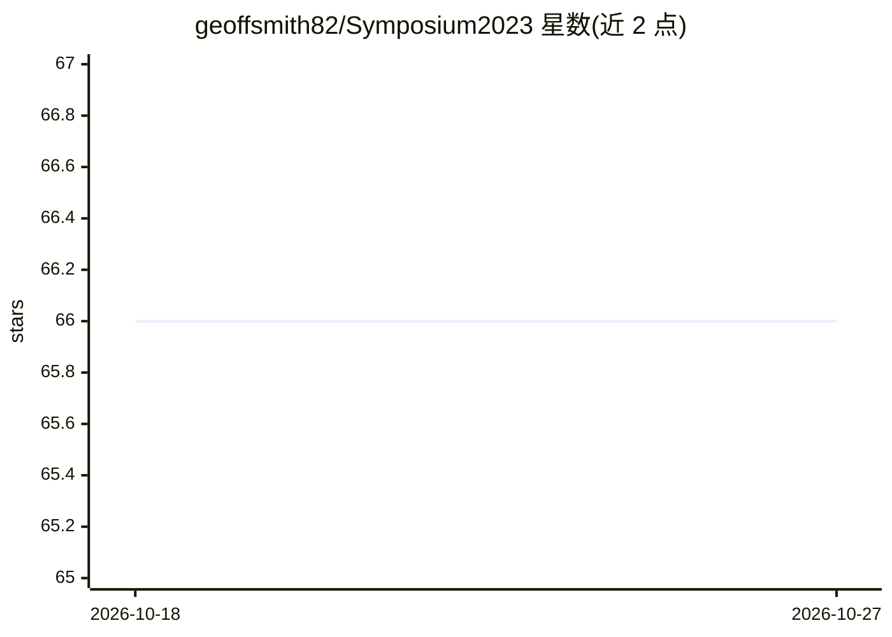

# geoffsmith82/Symposium2023

⭐ 66 · Pascal · MIT · 推送 2026-07-28 · [GitHub](https://github.com/geoffsmith82/Symposium2023) · 个人维护

**Delphi 开发者接入各类 AI 服务的示例项目与通用接口集**

源于 2023 年 ADUG Symposium 演讲的 Delphi AI 演示代码集合：提供语音识别、文本转语音、语言翻译、图像生成、人脸检测、语音聊天机器人、发票 PDF 提取等示例程序，并为不同 AI 提供商（OpenAI、Azure、Anthropic、Groq、xAI、Google 等）创建可互换的通用 API 接口，便于实验、按价格切换或避免供应商锁定。使用前需在各云服务控制台开通并配置 API key。

## 筛选速览

| 维度 | 判定 | 备注 |
|---|---|---|
| AI 角色 | `ai-ecosystem` | LLM/agent 周边工具 |
| 许可风险 | `permissive` | MIT |
| 部署形态 | `None` |  |
| 模型依赖 | locked-api |  |
| 硬件要求 | — | 无带数字的原话,不猜 |
| 安装摩擦 | `low` | 无编译、无系统依赖或容器化 |
| 成熟度 | — | 结构信号不足 |

## 能力要点

- 覆盖 TTS/ASR/翻译/图像生成/人脸检测等 12+ 个 Delphi 示例程序
- 通用接口设计，多提供商可互换以避免供应商锁定
- LLM 功能矩阵：8 家提供商的视觉、函数调用、图像生成支持对照
- 包含 MCP Server、GPT Action 服务器等接入演示

## 适用场景

- Delphi 桌面应用中集成语音识别与语音对话
- 为多语言 Delphi 程序做翻译辅助
- 对比和切换不同云 AI 提供商的能力与价格

## 场景标签

`聊天机器人` `图像生成` `语音合成` `语音识别` · 领域:对话与助手

## 证据(README 行号)

> L6: The goal of this project is to enable delphi users to be able to use AI technology in their applications. There are 
> L16: The example programs below is an attempt to demonstrate the capabilities available to Delphi programmers today. I h

## 星数曲线

2026-10-18 66 → 2026-10-27 66（+0）

---
*卡片 v1 · prompt 1.4 · 生成 2026-10-24 · 置信度 high · 依据 README sha `db386213a86f` · [字段定义](../../DATASET.md)*
