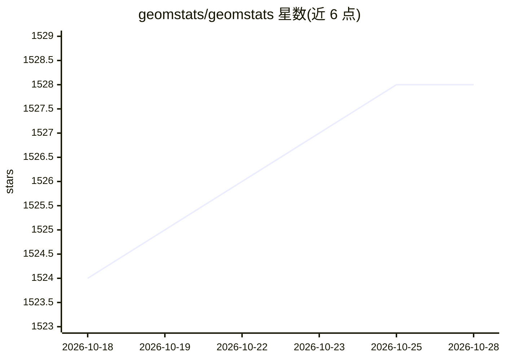

# geomstats/geomstats

⭐ 1,527 · Python · MIT · 推送 2026-10-07 · [GitHub](https://github.com/geomstats/geomstats) · [官网](http://geomstats.ai) · 组织维护

**流形上的几何计算与统计机器学习 Python 库**

Geomstats 提供 manifolds 上的计算、统计、机器学习与深度学习能力，分为 geometry（微分几何：流形、李群、纤维丛、形状空间、信息流形、黎曼度规等）与 learning（流形数据上的统计与学习算法）两大模块。用户可在 NumPy、Autograd、PyTorch 三种后端间切换，通过环境变量 GEOMSTATS_BACKEND 指定，默认 NumPy，可视化仅在该后端可用。算法（如 TangentPCA）可与包内任意流形和度规组合使用。通过 pip、conda 或 git 提供，需 Python3。

## 筛选速览

| 维度 | 判定 | 备注 |
|---|---|---|
| AI 角色 | `ai-native` | 本体是模型或模型工具 |
| 许可风险 | `permissive` | MIT |
| 部署形态 | `library` | 以包/库形式分发 |
| 模型依赖 | — | README 未给出锁定关系 |
| 硬件要求 | — | 无带数字的原话,不猜 |
| 安装摩擦 | `low` | 无编译、无系统依赖或容器化 |
| 成熟度 | — | 结构信号不足 |

## 能力要点

- geometry 与 learning 双模块结构，覆盖流形/李群/形状空间/信息流形等几何对象
- NumPy / Autograd / PyTorch 三后端可切换，默认 NumPy
- 提供 TangentPCA 等流形学习算法，可与包内任意流形和度规组合
- 在 JMLR、FnT ML、ACM TOMS 等期刊发表多篇配套论文

## 适用场景

- 在李群或形状空间等流形数据上做统计与降维（如切空间 PCA）
- 实现黎曼几何相关的研究算法并进行可复现实验
- 结合 PyTorch 后端做流形上的深度学习计算

## 场景标签

 · 领域:科学计算/几何机器学习

## 证据(README 行号)

> L5: **Geomstats** is a Python package for computations, statistics, machine learning and deep learning on manifolds.
> L9: The module *learning* implements statistics and learning algorithms for data on manifolds. Users can choose between 

## 星数曲线

2026-10-18 1,524 → 2026-10-28 1,528（+4）

---
*卡片 v1 · prompt 1.4 · 生成 2026-10-21 · 置信度 high · 依据 README sha `ac6d21ad29df` · [字段定义](../../DATASET.md)*
