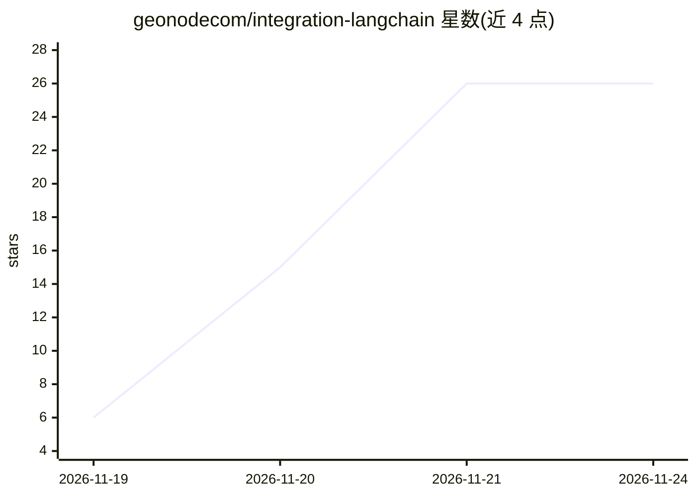

# geonodecom/integration-langchain

⭐ 26 · Python · MIT · 推送 2026-10-29 · [GitHub](https://github.com/geonodecom/integration-langchain) · [官网](https://geonode.com/integrations) · 组织维护

**为 LangChain 代理提供网页抓取工具的集成包**

由 Geonode 发布的 Python 包：将提取页面、网络搜索、URL 发现、爬取与批量任务管理等操作封装为 LangChain 原生工具，供代理调用并获取带回源 URL 的网页内容，用于研究与 RAG 流程。依赖 Python 3.10+ 与 Geonode API key，模型凭证需另行配置；包自身仅依赖 langchain-core，需额外安装 langchain 才能组建代理。工具返回带 ok/error 的结构化结果，不含向量数据库或现成代理。

## 筛选速览

| 维度 | 判定 | 备注 |
|---|---|---|
| AI 角色 | `ai-ecosystem` | LLM/agent 周边工具 |
| 许可风险 | `permissive` | MIT |
| 部署形态 | `library` | 以包/库形式分发 |
| 模型依赖 | — | README 未给出锁定关系 |
| 硬件要求 | — | 无带数字的原话,不猜 |
| 安装摩擦 | `low` | 无编译、无系统依赖或容器化 |
| 成熟度 | — | 结构信号不足 |

## 能力要点

- 将 extract/search/map_urls/crawl/batch 等操作封装为 LangChain 原生工具
- 按任务选择可用 operations，限制代理的工具面
- 结构化返回（ok/operation/attempts/result 或带 retryable 的 error）与后台任务轮询工具
- 提供无模型的直接工具调用示例，便于先验证再接入代理

## 适用场景

- 让代理搜索并提取带来源 URL 的资料后作答
- 映射站点并批量提取 Markdown 构建检索语料
- 管理长时爬取/批量任务的状态与重试

## 场景标签

`网页抓取` `RAG` · 领域:效率与自动化

## 证据(README 行号)

> L3: # Geonode for LangChain: Web Scraping Tools for AI Agents
> L38: Install your model provider's integration and set its credentials separately. Set `LANGCHAIN_MODEL` to a model iden

## 星数曲线

2026-11-19 6 → 2026-11-24 26（+20）

---
*卡片 v1 · prompt 1.4 · 生成 2026-11-20 · 置信度 high · 依据 README sha `37db37d6509b` · [字段定义](../../DATASET.md)*
