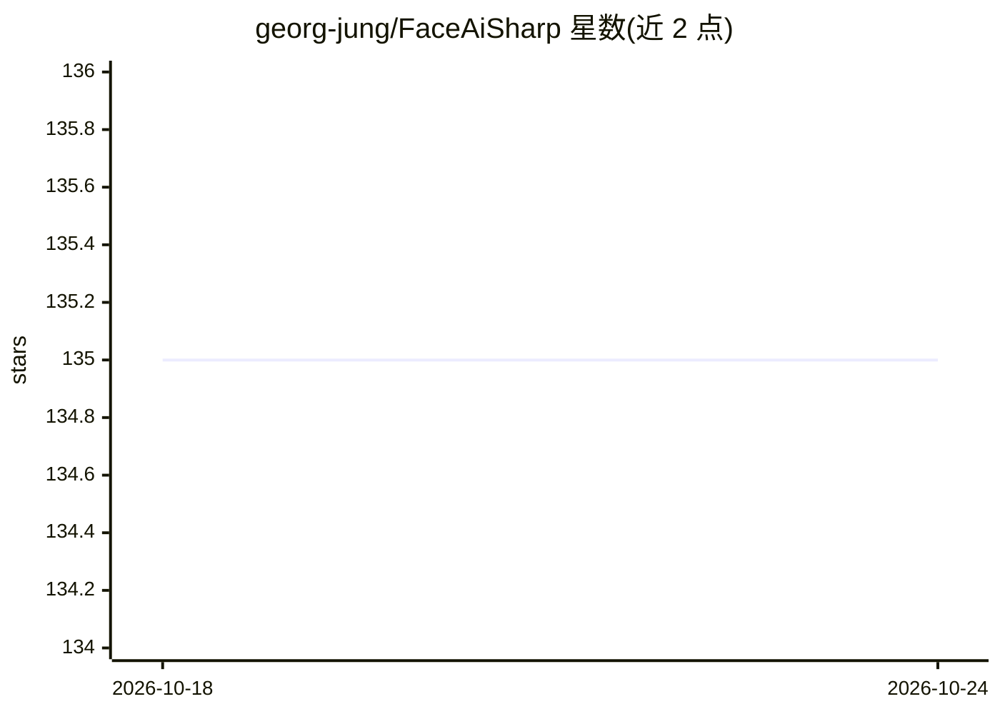

# georg-jung/FaceAiSharp

⭐ 136 · C# · MIT · 推送 2026-08-04 · [GitHub](https://github.com/georg-jung/FaceAiSharp) · [官网](https://nuget.org/packages/FaceAiSharp/) · 个人维护

**.NET 人脸检测/识别/关键点与眼睛状态库**

面向 .NET 开发者的计算机视觉库，封装公开的预训练 ONNX 模型，提供人脸检测、人脸识别、面部关键点检测（眼中心、鼻尖、嘴角）与眼睛开闭状态检测四类功能。模型推理基于 ONNXRuntime，支持硬件加速；图像读取使用 ImageSharp；全部本地处理，不依赖云服务。通过 NuGet 分发，Bundle 包含选定的模型（SCRFD、ArcFace、OpenVINO eye），也可自选或自带模型。跨平台支持 Windows、Linux、Android 等。注意所用 ONNX 模型受各自原始许可证约束，可能比 MIT 更严格。

## 筛选速览

| 维度 | 判定 | 备注 |
|---|---|---|
| AI 角色 | `ai-native` | 本体是模型或模型工具 |
| 许可风险 | `permissive` | MIT |
| 部署形态 | `None` |  |
| 模型依赖 | — | README 未给出锁定关系 |
| 硬件要求 | — | 无带数字的原话,不猜 |
| 安装摩擦 | `medium` | 含编译或系统依赖之一 |
| 成熟度 | — | 结构信号不足 |

## 能力要点

- 人脸检测、识别、关键点与眼睛状态四类功能，基于 ONNXRuntime 推理
- 全部本地处理，不依赖云服务
- NuGet Bundle 包内置模型，也支持自选/自带 ONNX 模型
- 跨平台支持 Windows、Linux、Android 等

## 适用场景

- 在 .NET 应用中集成人脸检测与识别
- 本地化部署的人脸验证，不依赖云端 API
- 提取面部关键点或判断眼睛开闭状态

## 场景标签

`人脸识别` · 领域:感知与多模态

## 证据(README 行号)

> L7: FaceAiSharp is a .NET library that allows you to work with face-related computer vision tasks. It currently provides
> L11: - **Face Detection**: Identifies the boundaries of faces within images.
> L12: - **Face Recognition**: Recognizes and distinguishes between different faces.

## 星数曲线

2026-10-18 135 → 2026-10-24 135（+0）

---
*卡片 v1 · prompt 1.4 · 生成 2026-10-22 · 置信度 high · 依据 README sha `2743182fad49` · [字段定义](../../DATASET.md)*
