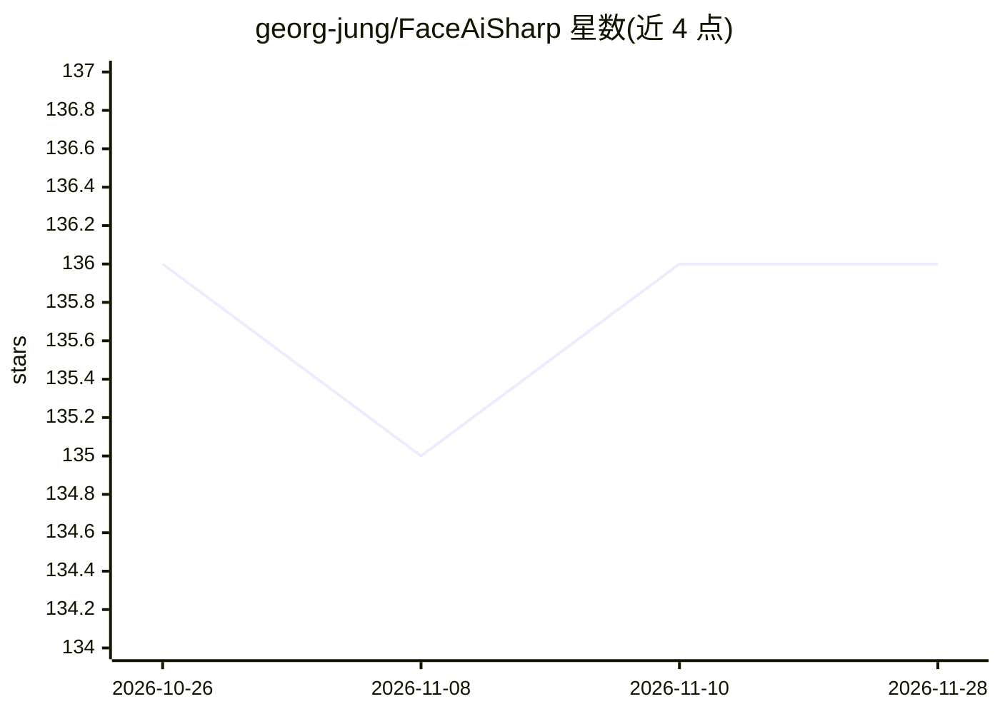

# georg-jung/FaceAiSharp

⭐ 136 · C# · MIT · 推送 2026-11-11 · [GitHub](https://github.com/georg-jung/FaceAiSharp) · [官网](https://nuget.org/packages/FaceAiSharp/) · 个人维护

**.NET 开发者的人脸检测/识别等本地推理库**

面向 .NET 应用的人脸计算机视觉库，提供人脸检测、人脸识别、面部关键点检测与睁闭眼状态检测四类功能。内部加载公开的预训练 ONNX 模型（SCRFD、ArcFace、Intel OpenVINO open-closed-eye-0001），通过 ONNXRuntime 推理并在硬件允许时启用加速；全部处理在本地完成，不依赖云服务。基于 ImageSharp 处理图像，支持 Windows、Linux、Android 等平台。模型各有独立许可，可能比库本身的 MIT 更严格。

## 筛选速览

| 维度 | 判定 | 备注 |
|---|---|---|
| AI 角色 | `ai-native` | 本体是模型或模型工具 |
| 许可风险 | `permissive` | MIT |
| 部署形态 | `None` |  |
| 模型依赖 | — | README 未给出锁定关系 |
| 硬件要求 | — | 无带数字的原话,不猜 |
| 安装摩擦 | `medium` | 含编译或系统依赖之一 |
| 成熟度 | — | 结构信号不足 |

## 能力要点

- 四类功能：人脸检测、人脸识别、面部关键点、睁闭眼检测
- 使用公开预训练 ONNX 模型，经 ONNXRuntime 推理
- 全部本地处理，不依赖云服务
- 跨平台支持 Windows、Linux、Android 等

## 适用场景

- 在 .NET 应用中检测图片中的人脸边界与关键点
- 本地人脸识别比对、区分不同个体
- 判断照片中人物眼睛是否睁开

## 场景标签

`人脸识别` · 领域:感知与多模态

## 证据(README 行号)

> L7: FaceAiSharp is a .NET library that allows you to work with face-related computer vision tasks. It currently provides
> L19: - All processing is done locally, with no reliance on cloud services.
> L22: - Cross-platform support for Windows, Linux, Android and more.

## 星数曲线

2026-10-26 136 → 2026-11-28 136（+0）

---
*卡片 v1 · prompt 1.4 · 生成 2026-11-28 · 置信度 high · 依据 README sha `f6f9b8787d17` · [字段定义](../../DATASET.md)*
