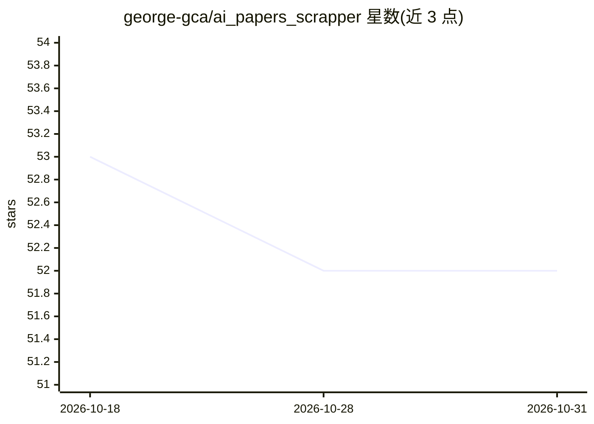

# george-gca/ai_papers_scrapper

⭐ 52 · Python · MIT · 推送 2026-09-15 · [GitHub](https://github.com/george-gca/ai_papers_scrapper) · 个人维护

**抓取主流 AI 会议论文 PDF 与元数据的爬虫工具**

基于 Scrapy 的爬虫项目：从 AAAI、ACL Anthology、CVPR、NeurIPS、ICML、ICLR 等多个公开来源下载论文 PDF、标题、摘要、作者与 URL 信息，按会议和年份分目录存储为 TSV 文件与 PDF 文件，支持 2017 年以来的会议。同一系列还拆分出论文清洗、聚类、搜索等配套项目。提供 Docker 与 Poetry 两种运行方式，入口为 start_here.sh 脚本。

## 筛选速览

| 维度 | 判定 | 备注 |
|---|---|---|
| AI 角色 | `ai-knowledge` | 知识聚合/清单类 |
| 许可风险 | `permissive` | MIT |
| 部署形态 | `self-host` | docker 或自建部署 |
| 模型依赖 | — | README 未给出锁定关系 |
| 硬件要求 | — | 无带数字的原话,不猜 |
| 安装摩擦 | `low` | 无编译、无系统依赖或容器化 |
| 成熟度 | — | 结构信号不足 |

## 能力要点

- 从 11 个来源抓取 20+ 个 AI 会议的论文 PDF 与元数据
- 按 会议/年份 目录结构输出 abstracts.tsv、authors.tsv、paper_info.tsv 与 PDF
- 提供 Dockerfile 与 Makefile 运行方式
- 支持 scrapy shell 交互调试

## 适用场景

- 批量收集某会议历年论文 PDF 与摘要用于离线研究
- 为论文聚类与检索系统构建语料库
- 获取论文的标题/作者/URL 元数据做文献分析

## 场景标签

`网页抓取` `科研工具` · 领域:效率与自动化

## 证据(README 行号)

> L3: Download papers pdfs and other information from main AI conferences (when publicly available) and store it on `./dat
> L28: |Source|Conferences|

## 星数曲线

2026-10-18 53 → 2026-10-31 52（-1）

---
*卡片 v1 · prompt 1.4 · 生成 2026-10-24 · 置信度 high · 依据 README sha `d5f2a55f7cef` · [字段定义](../../DATASET.md)*
