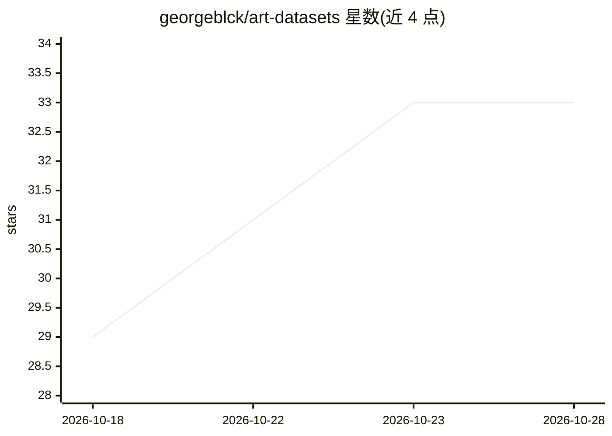

# georgeblck/art-datasets

⭐ 33 · 推送 2026-06-23 · [GitHub](https://github.com/georgeblck/art-datasets) · 个人维护

**机器学习艺术数据集策展清单：90+ 研究数据集与博物馆馆藏**

面向机器学习研究者与数字艺术史从业者的公开艺术数据集清单：按分类与目标检测、美学与情感、多模态问答、素描、伪造鉴别、生成式 AI、文化遗产、知识图谱等十余个类别组织 90+ 个研究数据集，并另列 35+ 博物馆开放获取馆藏。每个条目标注规模、年份、可获取性（直接下载/需申请/仅论文/仅浏览）与链接，部分条目附会议出处与许可信息；也记录失效下载链接等可用性状态。以 GitHub README 形式提供，接受 pull request 贡献。

## 筛选速览

| 维度 | 判定 | 备注 |
|---|---|---|
| AI 角色 | `ai-knowledge` | 知识聚合/清单类 |
| 许可风险 | `none` | — |
| 部署形态 | `None` |  |
| 模型依赖 | — | README 未给出锁定关系 |
| 硬件要求 | — | 无带数字的原话,不猜 |
| 安装摩擦 | `low` | 无编译、无系统依赖或容器化 |
| 成熟度 | — | 结构信号不足 |

## 能力要点

- 按任务类别组织的 90+ 艺术研究数据集条目
- 四级可用性标注（直接下载/需申请/仅论文/仅浏览）
- 另含 35+ 博物馆开放获取馆藏条目
- 记录数据集失效链接等可用性状态

## 适用场景

- 为艺术图像分类或美学模型训练寻找公开数据集
- 了解数字艺术史与文化遗产领域的开放数据资源
- 查找带论文出处与许可信息的可用数据集

## 场景标签

`精选清单` · 领域:学习与行业

## 证据(README 行号)

> L1: # Art Datasets for Machine Learning
> L3: A curated list of publicly available art datasets for machine learning research, covering classification, object det

## 星数曲线

2026-10-18 29 → 2026-10-28 33（+4）

---
*卡片 v1 · prompt 1.4 · 生成 2026-10-25 · 置信度 high · 依据 README sha `174a8c79d9a5` · [字段定义](../../DATASET.md)*
