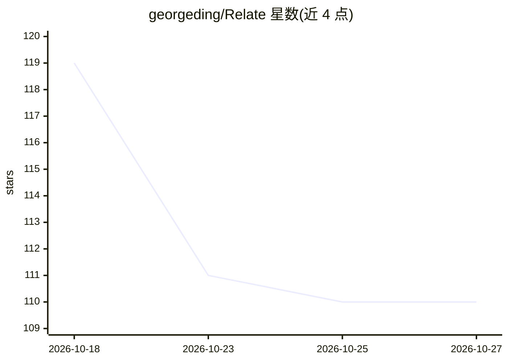

# georgeding/Relate

⭐ 110 · JavaScript · AGPL-3.0 · 推送 2026-09-28 · [GitHub](https://github.com/georgeding/Relate) · 个人维护 · 中文 README

**自托管的私人聊天 AI 幕僚：记住承诺与提醒日子**

运行在本机的 AI 助手服务：接入 Telegram、微信（可选 Windows 连接器）、邮件等聊天来源，自动提取承诺与未回复问题形成待办、维护记忆与敏感话题、基于完整聊天记录作答并附出处、代拟回复。以'空间'为单位组织（亲密关系/生意/团队），每个空间有独立聊天、记忆与看板，并可作为只读 MCP 服务器供 Claude 等工具调用。支持任意 OpenAI 兼容 API（含 Ollama 本地运行），消息数据仅存本机。Windows 提供安装包与便携版；macOS/Linux 需 Node.js 22+ 从源码运行。

## 筛选速览

| 维度 | 判定 | 备注 |
|---|---|---|
| AI 角色 | `ai-native` | 本体是模型或模型工具 |
| 许可风险 | `dual` | AGPL-3.0 |
| 部署形态 | `desktop` | 安装包/桌面程序 |
| 模型依赖 | local-ok | 支持本地模型 |
| 硬件要求 | — | 无带数字的原话,不猜 |
| 安装摩擦 | `low` | 无编译、无系统依赖或容器化 |
| 成熟度 | — | 结构信号不足 |

## 能力要点

- 自动提取承诺与未回复问题并闭环管理的待办系统
- 多空间架构：亲密关系/生意/团队各有独立记忆与看板
- 支持任意 OpenAI 兼容 API，可用 Ollama 完全本地运行
- 每个空间可作为只读 MCP 服务器接入 Claude Code 等工具

## 适用场景

- 跟踪亲密关系中的承诺、节日纪念日与回复提醒
- 管理客户与团队的待办、决策和协作健康度
- 基于完整聊天记录提问并获得带出处的回答

## 场景标签

`AI 助手` · 领域:对话与助手

## 证据(README 行号)

> L7:  一个跑在你自己电脑上的私人 AI 幕僚长：读懂聊天，记住承诺，提醒重要的日子。
> L20: - 💬 **想问就问** —— “我们周六说好了什么来着？”—— 基于完整聊天记录作答，并附出处。
> L42: 3. **设置 → AI 服务商** → 粘贴 API 密钥 → **测试**。

## 星数曲线

2026-10-18 119 → 2026-10-27 110（-9）

---
*卡片 v1 · prompt 1.4 · 生成 2026-10-23 · 置信度 mid · 依据 README sha `f24f41c18439` · [字段定义](../../DATASET.md)*
