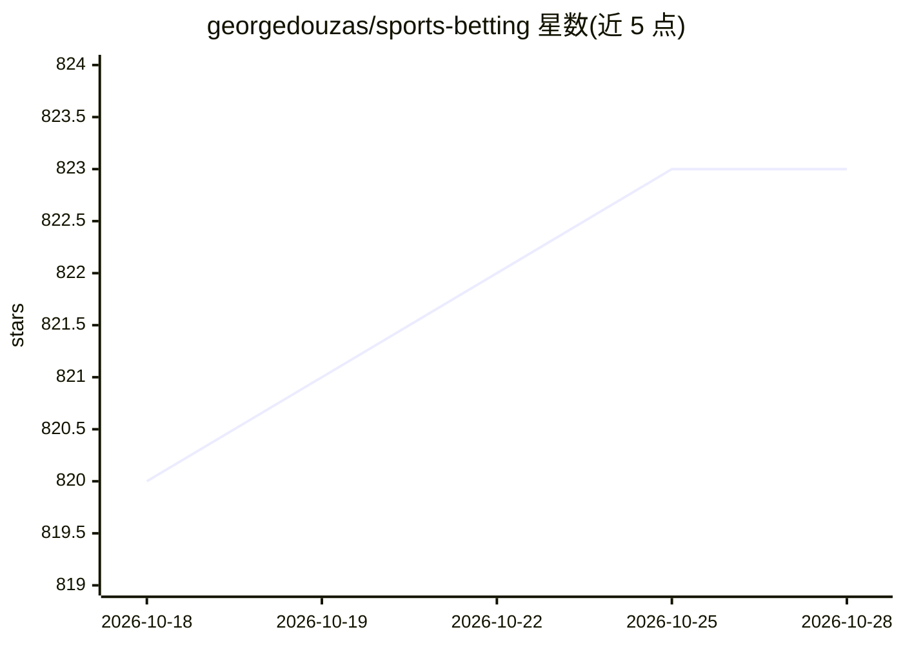

# georgedouzas/sports-betting

⭐ 824 · Python · MIT · 推送 2026-09-24 · [GitHub](https://github.com/georgedouzas/sports-betting) · [官网](https://georgedouzas.github.io/sports-betting) · 个人维护

**体育博彩建模工具库：构建、回测与执行投注策略**

提供 dataloader 与 bettor 两大组件：dataloader 从自选的统计源与赔率源下载数据并整理为建模格式；bettor 包装任意 scikit-learn 估计器，回测策略并预测 upcoming 赛事的价值投注。可从 AI agent（MCP server）、Python API 或命令行使用；execution 部分可经 bookmaker API 或 Playwright 驱动网站下单（花费真实资金，且自动操作网站违反多数庄家条款）。PyPI 安装，执行功能需额外安装 Chromium。

## 筛选速览

| 维度 | 判定 | 备注 |
|---|---|---|
| AI 角色 | `ai-ecosystem` | LLM/agent 周边工具 |
| 许可风险 | `permissive` | MIT |
| 部署形态 | `library` | 以包/库形式分发 |
| 模型依赖 | — | README 未给出锁定关系 |
| 硬件要求 | — | 无带数字的原话,不猜 |
| 安装摩擦 | `low` | 无编译、无系统依赖或容器化 |
| 成熟度 | — | 结构信号不足 |

## 能力要点

- dataloater 自选统计源与赔率源，数据来源可追溯
- bettor 包装任意 scikit-learn 估计器进行回测与价值投注预测
- 提供 MCP server，可由 AI agent 驱动全流程（探索数据、回测、下单）
- execution 通过 bookmaker API 或 Playwright 驱动网站下注

## 适用场景

- 我需要回测足球投注策略并计算收益率
- 让 AI agent 帮我下载赛事数据、建模并找出价值投注
- 通过命令行批量提取多联赛赛季数据并运行模型

## 场景标签

`金融量化` · 领域:学习与行业

## 证据(README 行号)

> L17: `sports-betting` is a set of tools for building, testing, and using sports betting models. You can use it from an A
> L24: - A bettor backtests a betting strategy and predicts the value bets of upcoming events. It wraps any scikit-learn

## 星数曲线

2026-10-18 820 → 2026-10-28 823（+3）

---
*卡片 v1 · prompt 1.4 · 生成 2026-10-22 · 置信度 high · 依据 README sha `e48a4d5731fe` · [字段定义](../../DATASET.md)*
