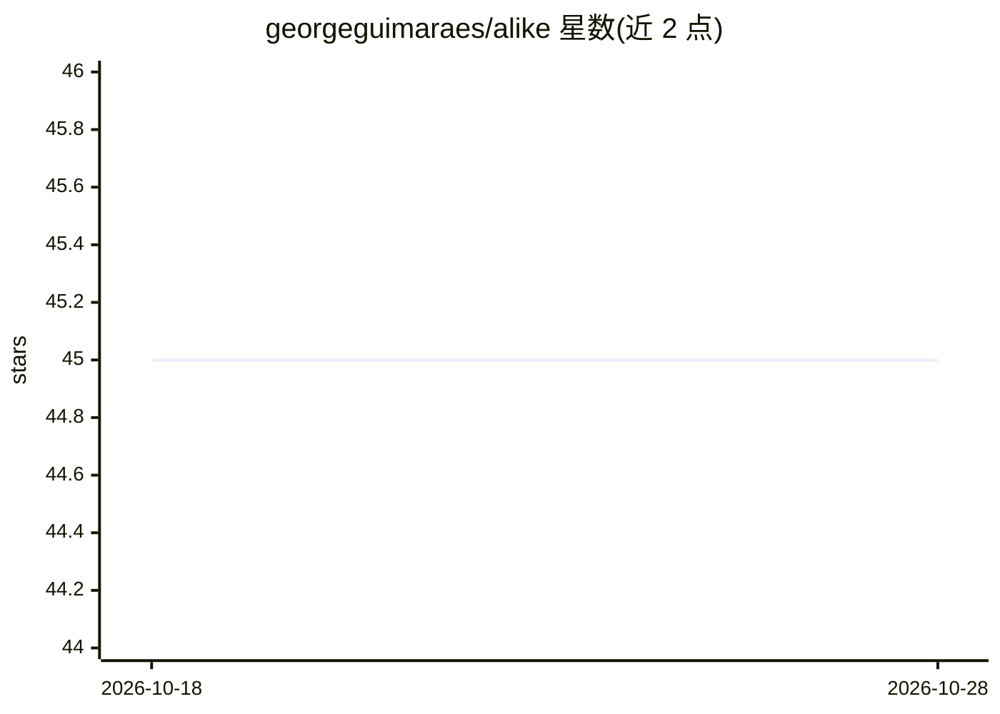

# georgeguimaraes/alike

⭐ 45 · Elixir · Apache-2.0 · 推送 2026-10-20 · [GitHub](https://github.com/georgeguimaraes/alike) · [官网](http://hexdocs.pm/alike) · 个人维护

**Elixir 语义相似度测试库：断言两句话含义相同**

面向 Elixir 开发者的 ExUnit 测试扩展：通过波浪操作符 `<~>` 断言两个句子语义相同，也可直接调用 alike?/3、similarity/2 与 NLI 分类函数。内部基于 Bumblebee 和 Nx 在本地运行两个模型——all-MiniLM-L6-v2 句嵌入模型计算余弦相似度、nli-distilroberta-base 检测矛盾关系。首次使用需下载约 460MB 模型并缓存在 ~/.cache/bumblebee/，相似度与矛盾判定阈值可配置，可切换 sentence-transformers 兼容模型，适用于 LLM 输出、翻译、摘要等自然语言生成结果的测试。

## 筛选速览

| 维度 | 判定 | 备注 |
|---|---|---|
| AI 角色 | `ai-ecosystem` | LLM/agent 周边工具 |
| 许可风险 | `permissive` | Apache-2.0 |
| 部署形态 | `None` |  |
| 模型依赖 | — | README 未给出锁定关系 |
| 硬件要求 | — | 无带数字的原话,不猜 |
| 安装摩擦 | `low` | 无编译、无系统依赖或容器化 |
| 成熟度 | — | 结构信号不足 |

## 能力要点

- 波浪操作符 <~> 形式的语义相似度测试断言
- 本地运行模型，无需 API key
- 嵌入模型 + NLI 模型组合，同时检测相似度与逻辑矛盾
- 相似度/矛盾阈值可配置，支持 sentence-transformers 兼容模型切换

## 适用场景

- 测试 LLM 或聊天机器人生成的回答是否符合预期含义
- 验证翻译结果是否保留原文语义
- 检验摘要是否覆盖文章主旨

## 场景标签

`模型评测` · 领域:评测与运维

## 证据(README 行号)

> L7: Alike lets you test if two sentences convey the same meaning using the expressive **wave operator** `<~>`. Perfect f
> L152: Alike uses two models that run locally on your machine, powered by Bumblebee and Nx:

## 星数曲线

2026-10-18 45 → 2026-10-28 45（+0）

---
*卡片 v1 · prompt 1.4 · 生成 2026-10-25 · 置信度 high · 依据 README sha `88c9fd33bb33` · [字段定义](../../DATASET.md)*
