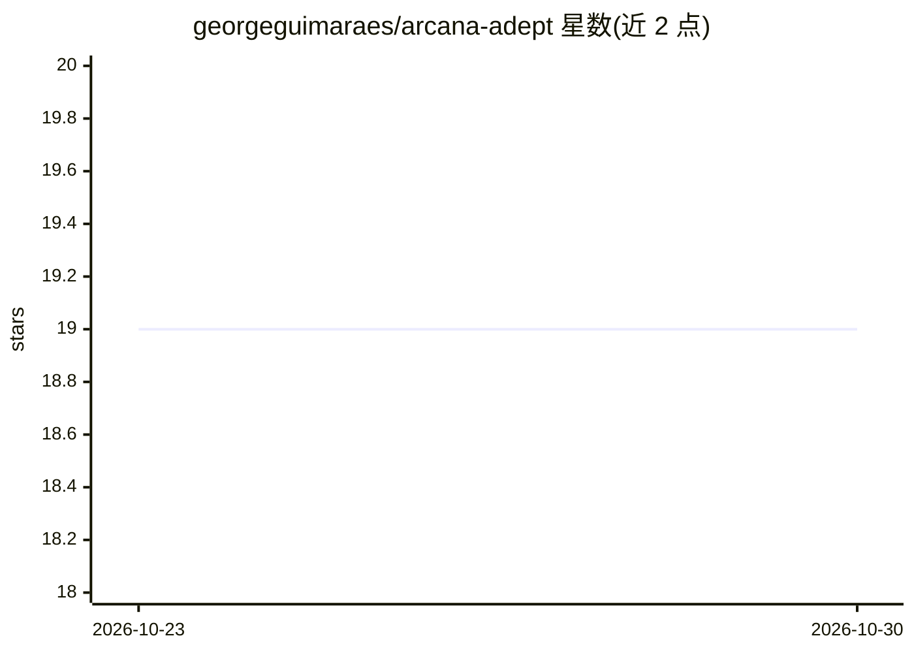

# georgeguimaraes/arcana-adept

⭐ 19 · Elixir · Apache-2.0 · 推送 2026-10-24 · [GitHub](https://github.com/georgeguimaraes/arcana-adept) · 个人维护

**演示 Arcana RAG 工具包的 Phoenix 示例应用**

基于 Elixir Phoenix 的示例应用，演示可嵌入式 RAG 库 Arcana 的用法：内置 Doctor Who 语料（TARDIS Wiki 10.8 万+条目），支持 MediaWiki XML dump 解析、并行 embedding 摄入、语义/全文/混合检索、GraphRAG 知识图谱构建（含社区摘要）与交叉编码器重排。内置仪表盘提供文档管理、检索测试与 RAG 问答，另带评测任务输出 MRR/Hit@k/Recall@k 及 LLM-as-judge 指标。嵌入通过 Nx 本地运行（EXLA，Apple Silicon 可换 EMLX），RAG 问答需配置 LLM（如 Z.ai token）。

## 筛选速览

| 维度 | 判定 | 备注 |
|---|---|---|
| AI 角色 | `ai-ecosystem` | LLM/agent 周边工具 |
| 许可风险 | `permissive` | Apache-2.0 |
| 部署形态 | `None` |  |
| 模型依赖 | — | README 未给出锁定关系 |
| 硬件要求 | — | 无带数字的原话,不猜 |
| 安装摩擦 | `low` | 无编译、无系统依赖或容器化 |
| 成熟度 | — | 结构信号不足 |

## 能力要点

- MediaWiki XML dump 解析与并行 embedding 摄入
- GraphRAG 知识图谱构建与社区摘要注入 ask 管线
- 交叉编码器重排（ms-marco-MiniLM-L-6-v2，经 Bumblebee）
- 评测任务输出 MRR/Hit@k/Recall@k 与 LLM-as-judge 指标

## 适用场景

- 学习如何在 Phoenix/Elixir 项目中集成 Arcana RAG 库
- 用内置 Doctor Who 语料试验 GraphRAG 与重排管线
- 跑检索评测基线对比 vector、graph、reranker 组合

## 场景标签

`RAG` `模型评测` · 领域:评测与运维

## 证据(README 行号)

> L3: Example Phoenix app demonstrating Arcana - an embeddable RAG library for Elixir.
> L124: - **Ask** - RAG-powered question answering (requires LLM config)

## 星数曲线

2026-10-23 19 → 2026-10-30 19（+0）

---
*卡片 v1 · prompt 1.4 · 生成 2026-10-28 · 置信度 high · 依据 README sha `b459828d95a7` · [字段定义](../../DATASET.md)*
