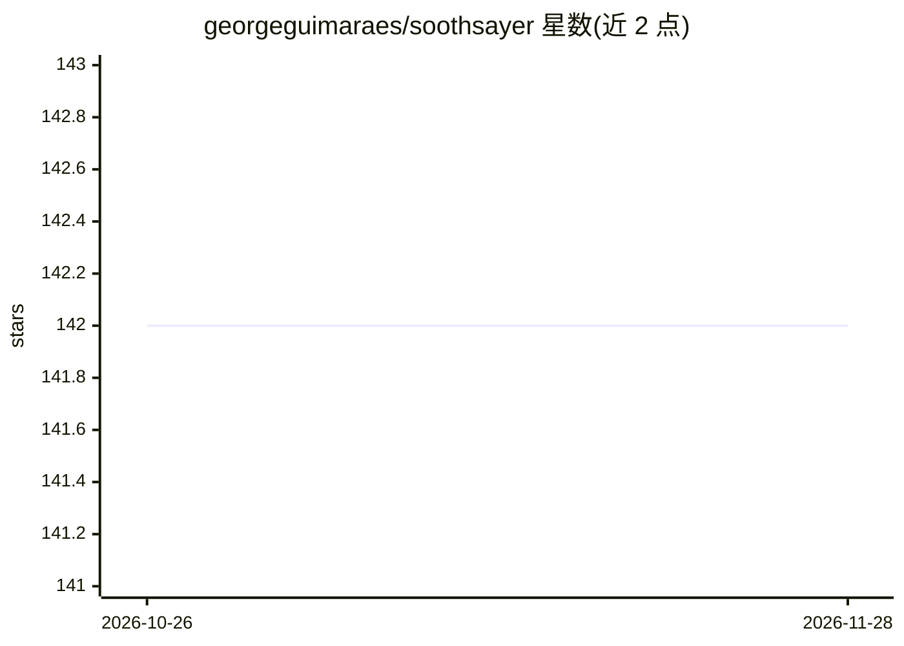

# georgeguimaraes/soothsayer

⭐ 142 · Elixir · Apache-2.0 · 推送 2026-11-24 · [GitHub](https://github.com/georgeguimaraes/soothsayer) · [官网](https://hexdocs.pm/soothsayer) · 个人维护

**Elixir 时间序列预测库：分解建模并用神经网络预测**

受 Prophet 与 NeuralProphet 启发的 Elixir 库，将时间序列分解为趋势、季节性、自回归、事件与回归器等可解释分量，用神经网络（Nx/EXLA/Axon 1.0/0.9）学习各分量。支持变点、L1 正则、Logistic 饱和趋势、乘性模式、事件窗口、200+ 国家节假日（dayoff）、多序列单模型、分位数头与 Huber/MAE/MSE 等损失，含学习率范围测试与近期样本加权。面向 Elixir 开发者，通过 mix.exs 依赖安装，提供 Livebook 交互教程。

## 筛选速览

| 维度 | 判定 | 备注 |
|---|---|---|
| AI 角色 | `ai-native` | 本体是模型或模型工具 |
| 许可风险 | `permissive` | Apache-2.0 |
| 部署形态 | `None` |  |
| 模型依赖 | — | README 未给出锁定关系 |
| 硬件要求 | — | 无带数字的原话,不猜 |
| 安装摩擦 | `medium` | 含编译或系统依赖之一 |
| 成熟度 | — | 结构信号不足 |

## 能力要点

- 分解为趋势/季节性/自回归/事件/回归器分量并输出各分量贡献
- 事件建模支持窗口、乘性模式与 200+ 国家节假日
- 支持 Deep AR-Net、分位数预测与学习率自动搜索
- 提供 Livebook 交互教程与网络结构图

## 适用场景

- 在 Elixir 项目中对业务或传感器序列做预测
- 建模节假日、促销等已知日期事件对序列的影响
- 用已知未来值的外部变量（气温、营销预算）辅助预测

## 场景标签

 · 领域:机器学习/时间序列预测

## 证据(README 行号)

> L5: Soothsayer is an Elixir library for time series forecasting, inspired by Facebook's Prophet and NeuralProphet. It de
> L21: Soothsayer runs on Nx 1.0, EXLA 1.0 and Axon 0.9.

## 星数曲线

2026-10-26 142 → 2026-11-28 142（+0）

---
*卡片 v1 · prompt 1.4 · 生成 2026-11-27 · 置信度 high · 依据 README sha `a9a35a0c4c0c` · [字段定义](../../DATASET.md)*
