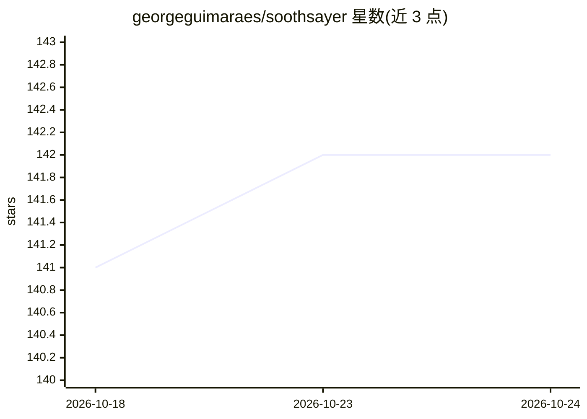

# georgeguimaraes/soothsayer

⭐ 142 · Elixir · Apache-2.0 · 推送 2026-10-20 · [GitHub](https://github.com/georgeguimaraes/soothsayer) · [官网](https://hexdocs.pm/soothsayer) · 个人维护

**Elixir 时间序列预测库，受 Prophet/NeuralProphet 启发**

用 Elixir 编写的时序预测库，将时间序列分解为趋势、季节性、自回归、事件与回归量等可解释成分，并以神经网络（基于 Nx/Axon）学习各成分模式。趋势支持变点、logistic 饱和增长；季节性用傅里叶项并支持乘法模式；事件支持窗口、乘法效应与 200+ 国节假日（dayoff 数据）；自回归支持深层 AR-Net 与 L1 正则；训练默认用 Huber 损失、自动学习率范围测试与最近样本加权，默认参数遵循 NeuralProphet。以 mix 依赖形式安装，需自行添加到 mix.exs 并运行 mix deps.get。

## 筛选速览

| 维度 | 判定 | 备注 |
|---|---|---|
| AI 角色 | `ai-native` | 本体是模型或模型工具 |
| 许可风险 | `permissive` | Apache-2.0 |
| 部署形态 | `None` |  |
| 模型依赖 | — | README 未给出锁定关系 |
| 硬件要求 | — | 无带数字的原话,不猜 |
| 安装摩擦 | `medium` | 含编译或系统依赖之一 |
| 成熟度 | — | 结构信号不足 |

## 能力要点

- 成分分解建模：趋势+季节性+自回归+事件+回归量，各成分可开关
- 深层 AR-Net 自回归与 quantile 分位数预测头
- 自动学习率范围测试与 one-cycle 调度，默认参数遵循 NeuralProphet
- 200+ 国家节假日事件建模（基于 dayoff），支持事件窗口与乘法效应

## 适用场景

- 在 Elixir 项目中对业务时序做带趋势与季节性的预测
- 对含节假日、促销等已知事件的序列建模并查看各事件学到的效应
- 对传感器等有惯性的序列做自回归预测并输出分位数区间

## 场景标签

 · 领域:机器学习/时间序列预测

## 证据(README 行号)

> L5: Soothsayer is an Elixir library for time series forecasting, inspired by Facebook's Prophet and NeuralProphet. It de
> L61: Soothsayer models time series as a sum of components:

## 星数曲线

2026-10-18 141 → 2026-10-24 142（+1）

---
*卡片 v1 · prompt 1.4 · 生成 2026-10-22 · 置信度 high · 依据 README sha `d115d130c252` · [字段定义](../../DATASET.md)*
