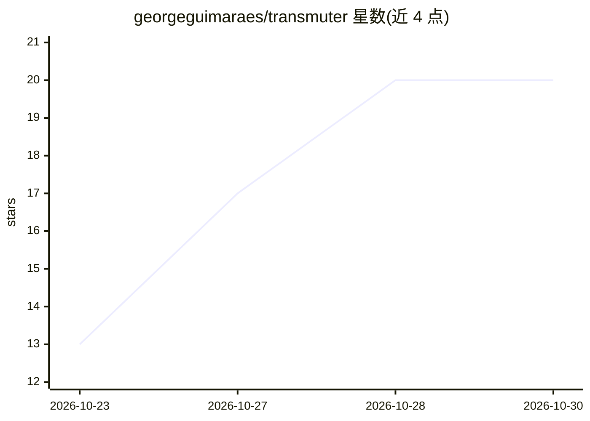

# georgeguimaraes/transmuter

⭐ 20 · Elixir · Apache-2.0 · 推送 2026-10-29 · [GitHub](https://github.com/georgeguimaraes/transmuter) · 个人维护

**Elixir 库：在任意 Nx 后端直接运行 Hugging Face ONNX 模型**

Transmuter 用 Nx 实现 ONNX 标准算子，按图逐算子执行 ONNX 导出的模型文件，从而无需为每个模型架构编写移植代码。后端可选 EMLX（Apple silicon GPU）或 EXLA（CUDA/CPU），输出为普通 Nx 张量，可入 defn、可求梯度、配合 Nx.Serving 使用。提供文本、视觉、音频三类 Serving API，覆盖嵌入、分类、生成、目标检测、语音识别、TTS 等任务；支持 f16/bf16 与 MatMulNBits 量化权重，并附图可视化、遥测与微调路径。给在 Elixir 生态中运行 Hugging Face 模型的开发者使用。

## 筛选速览

| 维度 | 判定 | 备注 |
|---|---|---|
| AI 角色 | `ai-ecosystem` | LLM/agent 周边工具 |
| 许可风险 | `permissive` | Apache-2.0 |
| 部署形态 | `None` |  |
| 模型依赖 | — | README 未给出锁定关系 |
| 硬件要求 | — | 无带数字的原话,不猜 |
| 安装摩擦 | `medium` | 含编译或系统依赖之一 |
| 成熟度 | — | 结构信号不足 |

## 能力要点

- 实现 ONNX 算子而非移植架构，新架构无需新代码
- 支持 EMLX（Apple silicon）与 EXLA（CUDA/CPU）后端，输出可被 Nx.Defn.grad 微分
- 文本/视觉/音频约 30 类任务 Serving，含生成、目标检测、语音识别、TTS
- 覆盖测试：75/77 Hugging Face 各任务热门导出仓库与 ONNX Runtime 输出一致

## 适用场景

- 在 Elixir 应用中直接运行 Bumblebee 未移植的 Hugging Face ONNX 模型
- 在 Apple silicon 上用 EMLX 或在 CUDA 上用 EXLA 做推理
- 对 ONNX 图求梯度并用 Polaris 等优化器微调
- 通过 Transmuter.Graph 可视化模型图与编译分段

## 场景标签

`推理引擎` · 领域:训练与推理

## 证据(README 行号)

> L3: Transmuter runs Hugging Face ONNX models on any Nx backend, with no per-architecture code. Use EMLX on Apple silicon
> L9: Transmuter implements each operator one time, as Nx operations. It then runs a model by running its graph, operator 
> L22: - The result is plain Nx. It runs on EMLX and EXLA, it works with `Nx.Serving`, and `Nx.Defn.grad` can differentiat

## 星数曲线

2026-10-23 13 → 2026-10-30 20（+7）

---
*卡片 v1 · prompt 1.4 · 生成 2026-10-28 · 置信度 high · 依据 README sha `6a2668f34461` · [字段定义](../../DATASET.md)*
