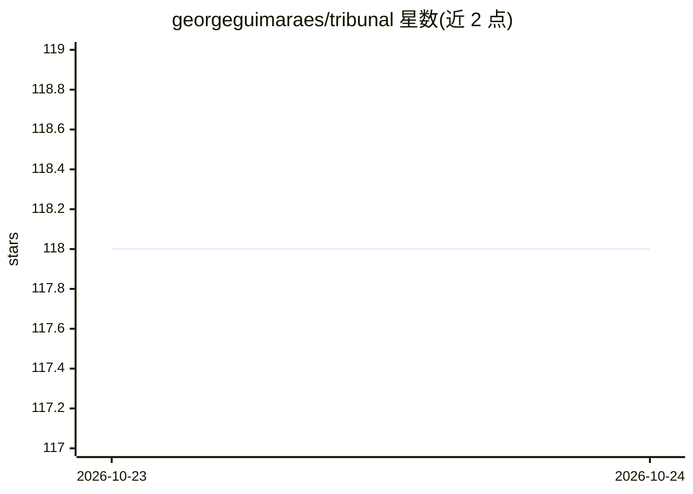

# georgeguimaraes/tribunal

⭐ 118 · Elixir · MIT · 推送 2026-10-20 · [GitHub](https://github.com/georgeguimaraes/tribunal) · 个人维护

**Elixir 的 LLM 输出评测框架：在 ExUnit/CI 中断言质量与安全**

面向在 Elixir 中构建 LLM 功能的开发者的评测框架：把忠实度、相关性、正确性、拒答、PII、毒性、策略合规等检查做成 ExUnit 断言宏（如 assert_faithful/refute_toxicity），随 mix test 与现有 CI 运行。提供两种模式：Test 模式（失败即失败，用于 CI 门禁）与 Evaluation 模式（Mix 任务 + YAML 策略，可配阈值、重复采样、基线跟踪）。包含确定性断言（编辑距离、contains、regex 等）、LLM-as-judge 指标（依赖 req_llm）、嵌入相似度（依赖 alike）与红队攻击模板。judge 与嵌入依赖均为可选；v3.0 移除了部分旧安全断言且无兼容别名。

## 筛选速览

| 维度 | 判定 | 备注 |
|---|---|---|
| AI 角色 | `ai-ecosystem` | LLM/agent 周边工具 |
| 许可风险 | `permissive` | MIT |
| 部署形态 | `None` |  |
| 模型依赖 | — | README 未给出锁定关系 |
| 硬件要求 | — | 无带数字的原话,不猜 |
| 安装摩擦 | `low` | 无编译、无系统依赖或容器化 |
| 成熟度 | — | 结构信号不足 |

## 能力要点

- LLM 质量断言作为 ExUnit 一等公民，运行于现有 mix test 与 CI
- Test 模式（快速失败）与 Evaluation 模式（Mix 任务 + YAML 策略 + 可配阈值）双模式
- LLM-as-judge 宏：faithful/relevant/correctness/refusal/no_pii/no_toxicity/no_policy_violation
- 数据集驱动评测（JSON/YAML，每行生成一个 ExUnit 测试）与静态红队攻击模板

## 适用场景

- 在 CI 中为 LLM 功能设置质量与安全门禁（含越狱防护）
- 批量运行数据集评测、对比模型并跟踪回归
- 对 RAG 回答做忠实度与相关性断言

## 场景标签

`模型评测` · 领域:评测与运维

## 证据(README 行号)

> L3: LLM evaluation framework for Elixir.
> L14: Tribunal makes LLM quality a first-class ExUnit citizen. You write `assert_faithful`, `assert_relevant`, and `refut

## 星数曲线

2026-10-23 118 → 2026-10-24 118（+0）

---
*卡片 v1 · prompt 1.4 · 生成 2026-10-23 · 置信度 high · 依据 README sha `854c526c5f07` · [字段定义](../../DATASET.md)*
