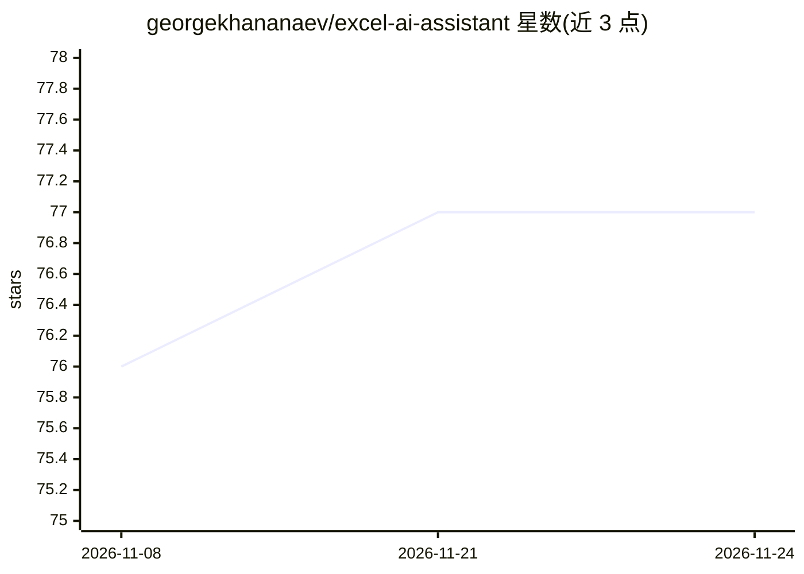

# georgekhananaev/excel-ai-assistant

⭐ 77 · Python · MIT · 推送 2026-11-08 · [GitHub](https://github.com/georgekhananaev/excel-ai-assistant) · 个人维护

**桌面应用：用 OpenAI 或本地 Ollama 对 Excel/CSV 做 AI 变换**

Python 桌面应用，读取 Excel 与 CSV 文件，对指定行列区间的单元格应用 AI 转换：清洗、格式化、翻译、摘要等，内置提示词模板并可自定义保存。支持双后端——OpenAI 云端 API 与本地 Ollama 模型（后者用于隐私/离线场景）。支持批次处理、自动保存回源文件、以其他列作为上下文提升转换效果。安装需 Python 3.13+ 与 uv，通过 git clone 与 uv sync 完成依赖安装，命令行启动。Ollama 为可选依赖。

## 筛选速览

| 维度 | 判定 | 备注 |
|---|---|---|
| AI 角色 | `ai-native` | 本体是模型或模型工具 |
| 许可风险 | `permissive` | MIT |
| 部署形态 | `library` | 以包/库形式分发 |
| 模型依赖 | local-ok | 支持本地模型 |
| 硬件要求 | — | 无带数字的原话,不猜 |
| 安装摩擦 | `low` | 无编译、无系统依赖或容器化 |
| 成熟度 | — | 结构信号不足 |

## 能力要点

- OpenAI API 与本地 Ollama 双 AI 后端可选
- 内置多类提示词模板并支持自定义保存
- 批次处理区间单元格并支持自动保存回源文件
- 可选用其他列数据作为转换上下文

## 适用场景

- 批量清洗和格式化 Excel/CSV 数据
- 用本地 Ollama 模型离线处理敏感表格数据
- 借助上下文列对单元格做翻译、摘要等转换

## 场景标签

`数据分析` · 领域:效率与自动化

## 证据(README 行号)

> L9: Excel AI Assistant is a Python-based desktop application that helps you apply intelligent transformations to your sp
> L17:  - **Ollama Integration**: Process data locally with open-source models for privacy and cost savings

## 星数曲线

2026-11-08 76 → 2026-11-24 77（+1）

---
*卡片 v1 · prompt 1.4 · 生成 2026-11-18 · 置信度 mid · 依据 README sha `aa587f80ed28` · [字段定义](../../DATASET.md)*
