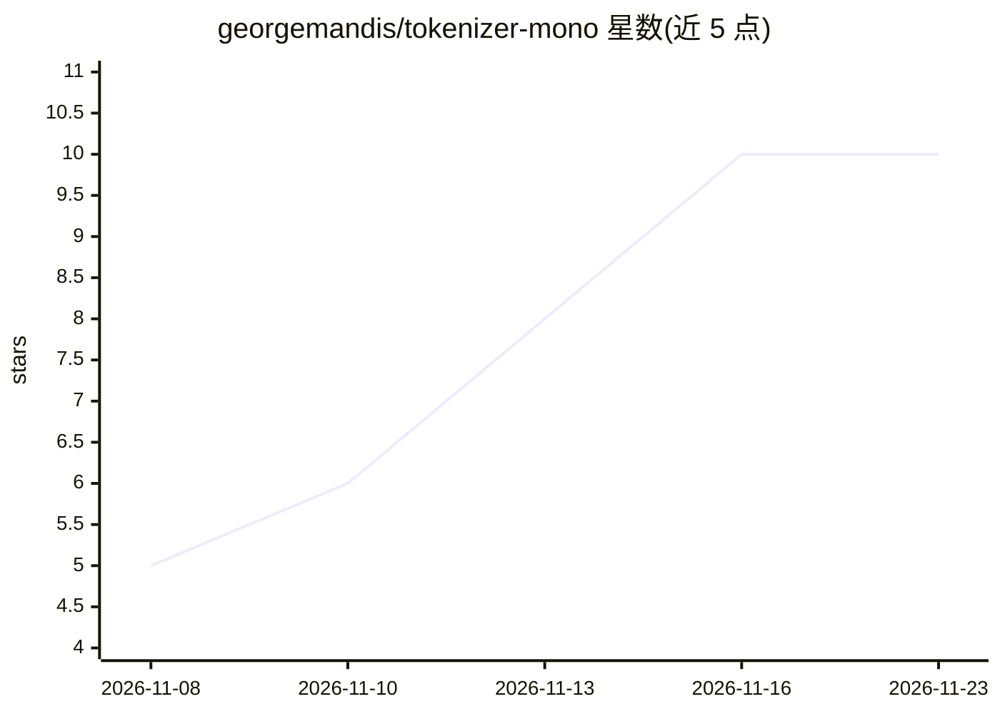

# georgemandis/tokenizer-mono

⭐ 10 · Python · OFL-1.1 · 推送 2026-11-14 · [GitHub](https://github.com/georgemandis/tokenizer-mono) · [官网](https://george.mand.is/2026/11/the-tokenizer-font/) · 个人维护

**高亮 LLM tokenizer 切分效果的等宽彩色字体**

基于 IBM Plex Mono 构建的彩色字体，通过 OpenType GSUB 替换规则近似各模型的 BPE tokenizer，在输入时以颜色区分 token 边界，无需 JavaScript。提供 28 个字形变体，每个对应一套 tokenizer 词表（cl100k、o200k、Llama、Gemma、Qwen、DeepSeek、Kimi K2 等），由 recipe.py 从词表生成。通过发布包（TTF/WOFF/WOFF2）或 npm 样式表分发，每个 release 附带与真实 tokenizer 的边界一致性精度数据；构建端另含 vocab.py、vocabdiff.py 等工具。

## 筛选速览

| 维度 | 判定 | 备注 |
|---|---|---|
| AI 角色 | `ai-knowledge` | 知识聚合/清单类 |
| 许可风险 | `viral` | OFL-1.1 |
| 部署形态 | `library` | 以包/库形式分发 |
| 模型依赖 | — | README 未给出锁定关系 |
| 硬件要求 | — | 无带数字的原话,不猜 |
| 安装摩擦 | `low` | 无编译、无系统依赖或容器化 |
| 成熟度 | — | 结构信号不足 |

## 能力要点

- 28 个字形变体，各对应一套 tokenizer 词表
- 纯 OpenType GSUB 规则实现，浏览器端无 JavaScript
- 发布附与真实 tokenizer 的 precision/recall 对照表（94.5%–99.5%）
- 支持 COLR 调色板切换深浅背景配色

## 适用场景

- 在编辑器中直观查看文本会被如何切分为 token
- 为不同模型的 tokenizer 词表做可视化对比
- 在网页中嵌入 token 高亮演示

## 场景标签

 · 领域:开发者工具/排版

## 证据(README 行号)

> L29: A color font, built on IBM Plex Mono, whose GSUB rules approximate a BPE
> L44: |variant|vocabulary|used by|
> L179: Boundary agreement with the real tokenizer on the corpus described below,

## 星数曲线

2026-11-08 5 → 2026-11-23 10（+5）

---
*卡片 v1 · prompt 1.4 · 生成 2026-11-19 · 置信度 high · 依据 README sha `d2d5cc9afbf0` · [字段定义](../../DATASET.md)*
