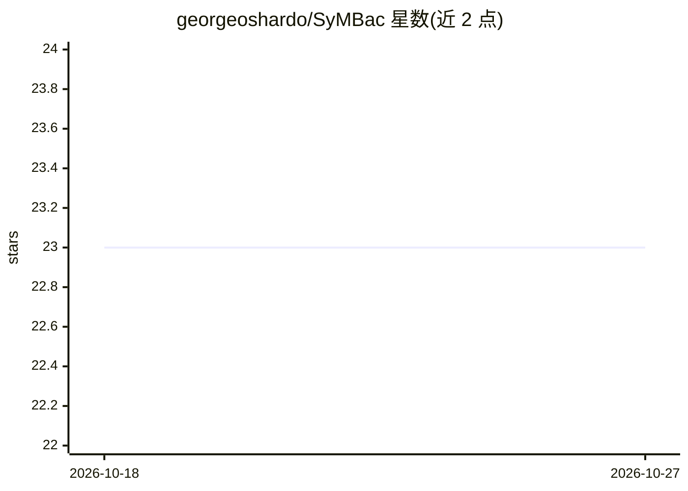

# georgeoshardo/SyMBac

⭐ 23 · Python · GPL-2.0 · 推送 2026-10-05 · [GitHub](https://github.com/georgeoshardo/SyMBac) · [官网](https://doi.org/10.1186/s12915-022-01453-6) · 个人维护

**为显微图像分割生成合成细菌训练图像的工具**

SyMBac 通过细菌生长的 segment-chain 物理模型、3D 细胞几何与相差/荧光光学（点扩散函数）建模，合成贴近用户实验条件的母机（mother machine）细菌显微图像，作为机器学习图像分割的训练数据。面向需自建训练集的显微成像研究者；本身不是机器学习工具，训练网络（如 U-net/DeLTA）需用户自行完成。以交互式 notebook + Qt/GTK 界面运行，需本地显示；GPU 强烈建议但可选，无 GPU 时回退 CPU FFT 卷积（约慢 40 倍）。目前仅支持母机培养场景。

## 筛选速览

| 维度 | 判定 | 备注 |
|---|---|---|
| AI 角色 | `ai-ecosystem` | LLM/agent 周边工具 |
| 许可风险 | `viral` | GPL-2.0 |
| 部署形态 | `library` | 以包/库形式分发 |
| 模型依赖 | — | README 未给出锁定关系 |
| 硬件要求 | `cpu-ok` | |
| 安装摩擦 | `medium` | 含编译或系统依赖之一 |
| 成熟度 | — | 结构信号不足 |

## 能力要点

- segment-chain 物理模型 + 3D 几何 + PSF 光学建模生成合成图像
- 支持相差与荧光成像，适配 20x 空气至 100x 油镜等物镜
- GPU（CuPy/CUDA、Apple Silicon MPS）可选加速，CPU 回退可用
- 提供 Colab 版本与训练 U-net（DeLTA 实现）的示例 notebook

## 适用场景

- 为母机细菌显微图像分割模型生成合成训练数据
- 按自家显微镜与微流控装置参数定制训练图像
- 替代手工标注，快速获得大量训练图像

## 场景标签

 · 领域:生物显微成像/合成数据生成

## 证据(README 行号)

> L38: That is up to you. SyMBac is **not** a machine learning tool. It is a tool to generate unlimited free training data
> L22: Because you're sick of generating your own training data by hand! Synthetic images provide an instant source of hig

## 星数曲线

2026-10-18 23 → 2026-10-27 23（+0）

---
*卡片 v1 · prompt 1.4 · 生成 2026-10-27 · 置信度 high · 依据 README sha `f4b9e8ed3a60` · [字段定义](../../DATASET.md)*
