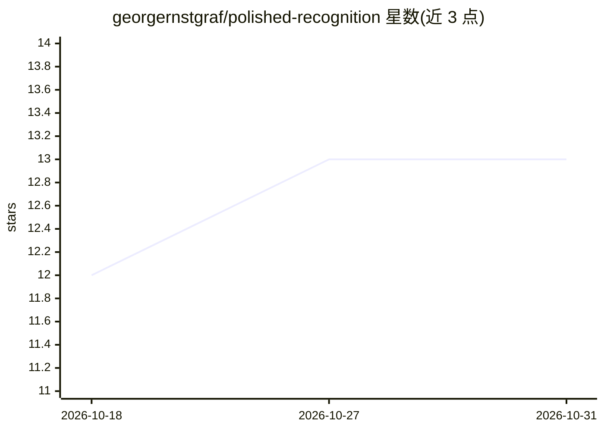

# georgernstgraf/polished-recognition

⭐ 13 · Kotlin · MIT · 推送 2026-10-19 · [GitHub](https://github.com/georgernstgraf/polished-recognition) · [官网](https://f-droid.org/packages/com.georgernstgraf.polishedrecognition) · 个人维护

**Android 语音键盘：自选 STT+LLM，把口述打磨成成品文字**

安装为 Android 输入法（IME）的语音键盘：切到该键盘即开始录音，音频发送到用户自选的 OpenAI 兼容 STT 提供商转录，再由用户自选的 LLM 按可编辑的自定义提示词润色（修标点、去填充词、翻译），成品文字插入任意应用输入框。内置 19 个提供商预设（OpenAI、GROQ、Ollama 本地等），支持 Raw 模式跳过 LLM 直接输出转录、暂停续录、可搜索模型列表。无账户无追踪，密钥与日志仅存本地。Google Play 处于封闭测试阶段，另有 F-Droid 渠道；限制：Gboard 的麦克风无法委托给第三方语音输入，需配合 HeliBoard/OpenBoard 等键盘使用。

## 筛选速览

| 维度 | 判定 | 备注 |
|---|---|---|
| AI 角色 | `ai-native` | 本体是模型或模型工具 |
| 许可风险 | `permissive` | MIT |
| 部署形态 | `None` |  |
| 模型依赖 | local-ok | 支持本地模型 |
| 硬件要求 | — | 无带数字的原话,不猜 |
| 安装摩擦 | `low` | 无编译、无系统依赖或容器化 |
| 成熟度 | `idea` | |

## 能力要点

- 19 个 STT/LLM 提供商预设，支持任意 OpenAI 兼容自定义 URL
- 自定义系统提示词与目标语言变量，LLM 润色或翻译口述内容
- Raw 模式跳过 LLM 直接插入原始转录
- 暂停/续录跨键盘切换保留录音，密钥日志仅存设备本地

## 适用场景

- 在任意应用的输入框用语音口述并自动得到润色后的文字
- 用本地 Ollama/LM Studio 实现不经第三方的语音输入
- 口述的同时翻译到指定目标语言

## 场景标签

`语音识别` · 领域:感知与多模态

## 证据(README 行号)

> L30: 3. **Tap send** → audio goes to your STT provider (Whisper on GROQ, OpenAI, …)
> L31: 4. **The LLM polishes the text** using your custom prompt — fix filler words and punctuation, restructure, or trans

## 星数曲线

2026-10-18 12 → 2026-10-31 13（+1）

---
*卡片 v1 · prompt 1.4 · 生成 2026-10-31 · 置信度 high · 依据 README sha `66546443bf25` · [字段定义](../../DATASET.md)*
