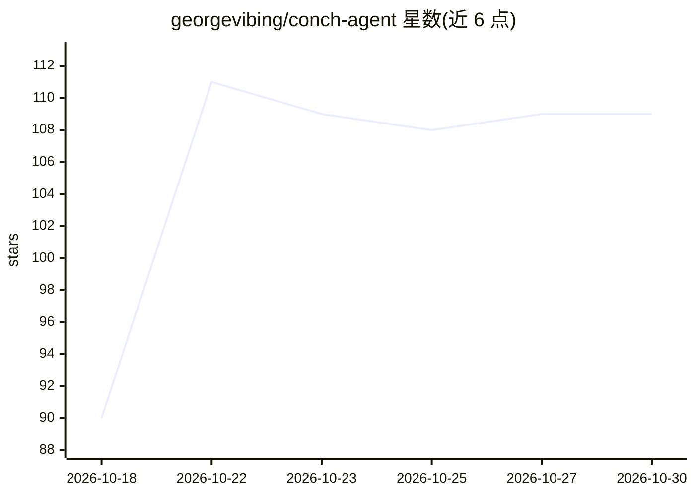

# georgevibing/conch-agent

⭐ 109 · TypeScript · MIT · 推送 2026-10-27 · [GitHub](https://github.com/georgevibing/conch-agent) · [官网](https://conchagent.com) · 个人维护

**自托管的统一 AI 助手客户端：把已付费的各家模型聚合在一个应用里**

自托管的桌面/Web/手机/聊天应用（Telegram、Discord、WhatsApp 等），用一个选择器接入用户已有的模型订阅与 API key：Claude Code、Codex、GitHub Copilot、Gemini CLI、Grok，以及 OpenRouter、Anthropic、OpenAI、DeepSeek 等 key，Ollama 或 LM Studio 可做离线模型。支持多 agent 协作、日程/邮件等应用集成、例行任务、可观看的浏览器与终端、四种权限模式。数据存于本地 ~/.conch，无账号无遥测；本体免费，模型费用按用户自己的计划。架构为 Node 网关（Fastify）+ React 应用 + Electron 桌面端。

## 筛选速览

| 维度 | 判定 | 备注 |
|---|---|---|
| AI 角色 | `ai-native` | 本体是模型或模型工具 |
| 许可风险 | `permissive` | MIT |
| 部署形态 | `library` | 以包/库形式分发 |
| 模型依赖 | local-ok | 支持本地模型 |
| 硬件要求 | — | 无带数字的原话,不猜 |
| 安装摩擦 | `low` | 无编译、无系统依赖或容器化 |
| 成熟度 | `idea` | |

## 能力要点

- 一个选择器聚合多家模型订阅与 API key，聊天中可切换模型且保留上下文
- 多 agent 对话协作（@提及、轮流发言、防循环）与后台任务
- 接入日历、邮件、Slack、GitHub 等应用，支持只读/询问/自动/完全信任四档权限
- 通过 Telegram/Discord/WhatsApp/iMessage 等聊天应用访问，数据存本地 ~/.conch

## 适用场景

- 把我已付费的多个 AI 订阅和 key 聚合到一个应用里使用
- 让助手通过 Telegram 或手机私人地址随时响应例行任务
- 用 Ollama/LM Studio 做私有离线模型的统一客户端
- 多 agent 协作处理研究、写作等分工任务

## 场景标签

`AI 助手` `多智能体` · 领域:Agent 开发

## 证据(README 行号)

> L109: - **Every model you have, one picker.** The plans you already pay for, with their own
> L111:  Anthropic, OpenAI, Google, Mistral, DeepSeek and more. Ollama or LM Studio for a

## 星数曲线

2026-10-18 90 → 2026-10-30 109（+19）

---
*卡片 v1 · prompt 1.4 · 生成 2026-10-23 · 置信度 mid · 依据 README sha `a5d4e23fec46` · [字段定义](../../DATASET.md)*
