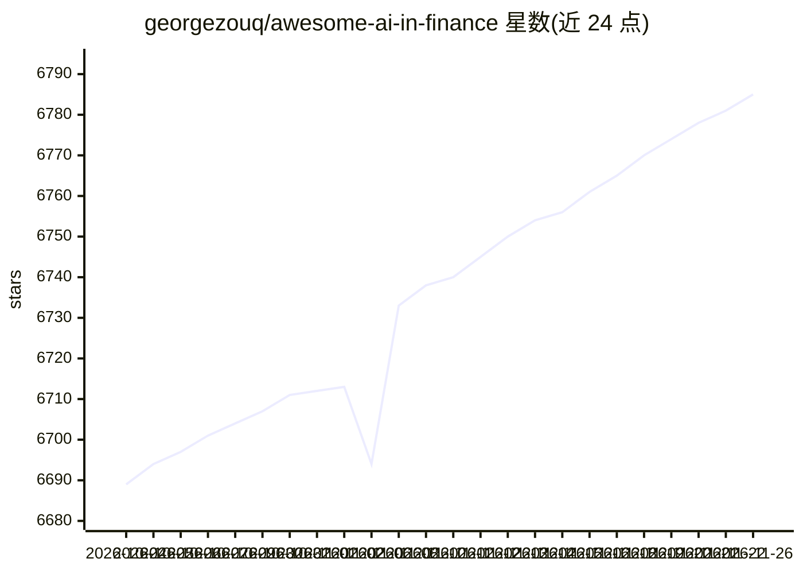

# georgezouq/awesome-ai-in-finance

⭐ 6,785 · CC0-1.0 · 推送 2026-11-12 · [GitHub](https://github.com/georgezouq/awesome-ai-in-finance) · [官网](https://medium.com/@zousongqi0213/how-people-use-ai-in-finance-59f0a7512b4) · 个人维护 · 中文 README

**金融领域 AI/LLM 资源策展清单，面向量化研究与实践者**

收录金融市场中使用的 AI 研究、工具与代码的 awesome 清单，按 Agents、LLMs、Skills、MCP Servers（市场数据与交易执行）等章节组织。条目涵盖交易 Agent 框架、金融大模型与基准（PIXIU、FinGPT 等）、ESG 评测数据集，以及连接 Claude/Cursor 等 AI 助手与市场数据、券商交易 API 的 MCP 服务器。提供中文资源入口。本身为链接清单，不含安装或运行说明。

## 筛选速览

| 维度 | 判定 | 备注 |
|---|---|---|
| AI 角色 | `ai-knowledge` | 知识聚合/清单类 |
| 许可风险 | `viral` | CC0-1.0 |
| 部署形态 | `None` |  |
| 模型依赖 | — | README 未给出锁定关系 |
| 硬件要求 | — | 无带数字的原话,不猜 |
| 安装摩擦 | `low` | 无编译、无系统依赖或容器化 |
| 成熟度 | — | 结构信号不足 |

## 能力要点

- 按 Agents/LLMs/Skills/MCP Servers 分类组织条目
- 收录金融 LLM 与基准（PIXIU、FinGPT、FinRpt 等）
- MCP 章节列出市场数据与交易执行两类服务器
- 提供中文资源章节

## 适用场景

- 查找金融交易与量化研究的开源 AI 工具
- 了解金融领域 LLM 与评测基准生态
- 为 AI 助手挑选金融数据/交易类 MCP 服务器

## 场景标签

`精选清单` `金融量化` · 领域:学习与行业

## 证据(README 行号)

> L1: # Awesome AI in Finance Awesome Community
> L4: With the power of the latest artificial intelligence research, people analyze & trade automatically and intelligentl
> L8: ## Contents

## 星数曲线

2026-10-24 6,689 → 2026-11-26 6,785（+96）

---
*卡片 v1 · prompt 1.4 · 生成 2026-11-22 · 置信度 high · 依据 README sha `423a14be6a43` · [字段定义](../../DATASET.md)*
