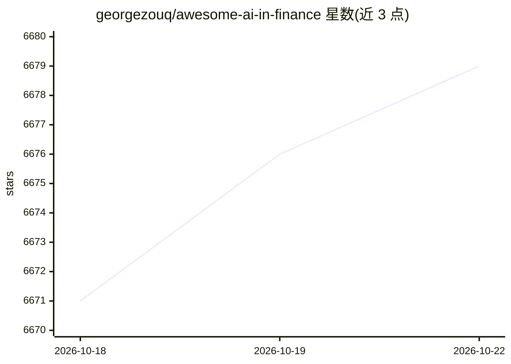

# georgezouq/awesome-ai-in-finance

⭐ 6,681 · CC0-1.0 · 推送 2026-09-08 · [GitHub](https://github.com/georgezouq/awesome-ai-in-finance) · [官网](https://medium.com/@zousongqi0213/how-people-use-ai-in-finance-59f0a7512b4) · 个人维护 · 中文 README

**金融市场 AI 应用与研究的策展清单（Agent/LLM/MCP/论文）**

面向量化交易与金融研究社区的资源聚合清单：按类别收录 AI 交易 Agent（如 TradingAgents、FinRobot）、金融 LLM 与基准（FinGPT、PIXIU、Nof1）、Claude 技能、连接金融数据与交易 API 的 MCP 服务器（行情、下单、研究），以及强化学习交易等经典论文。条目为链接加一句话描述，不提供可运行代码本身，含中文资源入口。

## 筛选速览

| 维度 | 判定 | 备注 |
|---|---|---|
| AI 角色 | `ai-knowledge` | 知识聚合/清单类 |
| 许可风险 | `viral` | CC0-1.0 |
| 部署形态 | `None` |  |
| 模型依赖 | — | README 未给出锁定关系 |
| 硬件要求 | — | 无带数字的原话,不猜 |
| 安装摩擦 | `low` | 无编译、无系统依赖或容器化 |
| 成熟度 | — | 结构信号不足 |

## 能力要点

- 收录 AI 交易 Agent、金融 LLM 基准与数据集条目
- 按 Market Data / Trading Execution / Research 分类整理金融 MCP 服务器
- 收录强化学习交易方向的经典论文条目
- 提供中文资源入口

## 适用场景

- 寻找金融领域的 AI 交易 Agent 或分析框架
- 为 AI 助手查找金融数据与交易接口的 MCP 服务器
- 查阅金融 AI 与强化学习交易的研究文献线索

## 场景标签

`精选清单` `金融量化` · 领域:学习与行业

## 证据(README 行号)

> L4: With the power of the latest artificial intelligence research, people analyze & trade automatically and intelligentl
> L8: ## Contents

## 星数曲线

2026-10-18 6,671 → 2026-10-22 6,679（+8）

---
*卡片 v1 · prompt 1.4 · 生成 2026-10-20 · 置信度 high · 依据 README sha `aefa3f9a20ff` · [字段定义](../../DATASET.md)*
