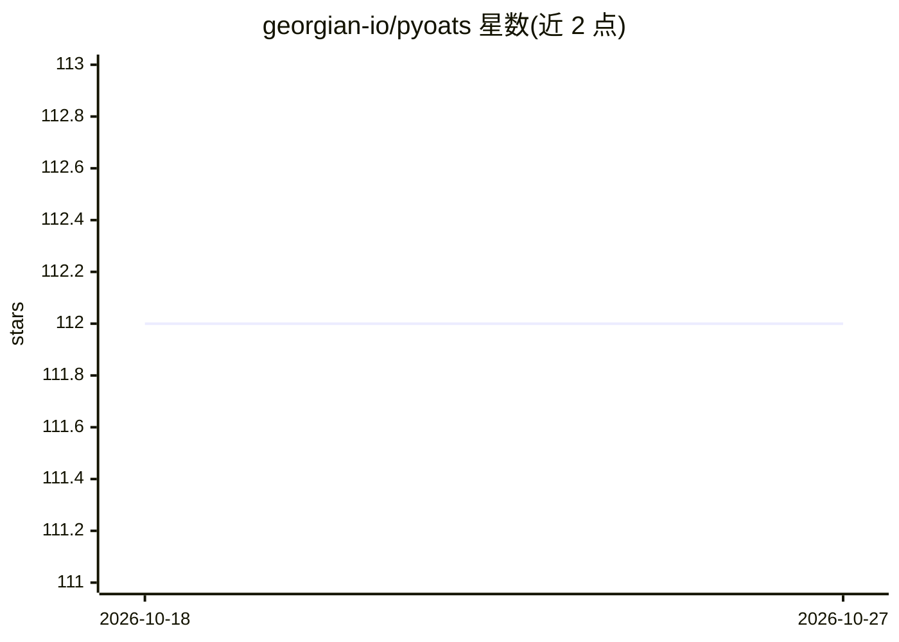

# georgian-io/pyoats

⭐ 112 · Python · Apache-2.0 · 推送 2026-10-22 · [GitHub](https://github.com/georgian-io/pyoats) · 组织维护

**面向时间序列的异常检测 Python 库，统一接口适配多模型**

由 Georgian 维护的时间序列异常检测库：将预测型（ARIMA、N-BEATS、N-HiTS、TFT 等）、距离型（Isolation Forest、Matrix Profile）、重构型（VAE、TranAD）与规则型（Quantile）等 17 种检测方法统一到同一接口，支持单变量与多变量输入并保证输出形状一致，另提供 Quantile 等阈值选择工具。深度学习模型依赖 PyTorch 或 TensorFlow。安装途径为 uv（源码 clone 后 uv sync）或 Docker 镜像（支持 GPU），Python 版本要求 3.9-3.12。

## 筛选速览

| 维度 | 判定 | 备注 |
|---|---|---|
| AI 角色 | `ai-native` | 本体是模型或模型工具 |
| 许可风险 | `permissive` | Apache-2.0 |
| 部署形态 | `self-host` | docker 或自建部署 |
| 模型依赖 | — | README 未给出锁定关系 |
| 硬件要求 | `cpu-ok` | |
| 安装摩擦 | `low` | 无编译、无系统依赖或容器化 |
| 成熟度 | — | 结构信号不足 |

## 能力要点

- 统一接口封装 17 种检测模型，分预测型/距离型/重构型/规则型四类
- 支持单变量与多变量时间序列，保证相同输出形状
- 提供 QuantileThreshold 等异常阈值选择工具
- 基于 Darts/PyOD/statsmodels/stumpy 等现有实现构建

## 适用场景

- 对时间序列数据计算异常分数并设定阈值判定异常
- 在统一接口下切换多种检测模型进行对比实验
- 在 GPU 或容器化环境中运行深度学习异常检测

## 场景标签

 · 领域:机器学习/时间序列分析

## 证据(README 行号)

> L14:  Quick and Easy Outlier Detection for Time Series
> L46: We present a straight-forward interface for popular, state-of-the-art detection methods to assist you in your exper

## 星数曲线

2026-10-18 112 → 2026-10-27 112（+0）

---
*卡片 v1 · prompt 1.4 · 生成 2026-10-23 · 置信度 high · 依据 README sha `d8dd3fa796e3` · [字段定义](../../DATASET.md)*
