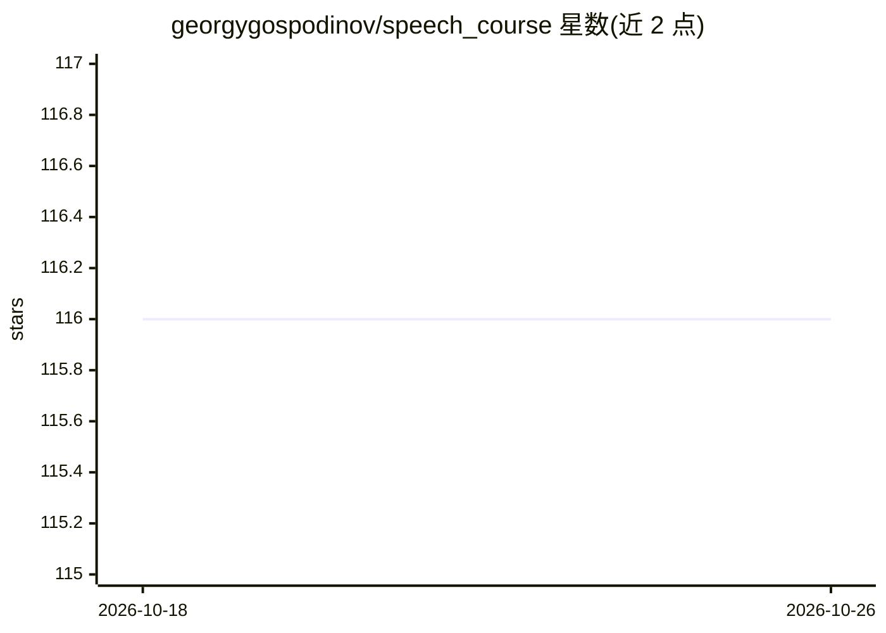

# georgygospodinov/speech_course

⭐ 116 · Jupyter Notebook · 推送 2026-10-15 · [GitHub](https://github.com/georgygospodinov/speech_course) · 组织维护

**MIPT 2025 秋季语音深度学习课程大纲仓库**

莫斯科物理技术学院（MIPT）2025 年秋季语音深度学习课程的课程页仓库：以表格列出 14 次课的日期与主题，覆盖数字信号处理、关键词检出、CTC/编码器-解码器等语音识别方法、自监督学习（wav2vec2.0、HuBERT、BEST-RQ、GigaAM）、说话人识别、VAD 与说话人分离、音频条件 LLM、TTS 与语音到语音 LLM，每次课附 slides/录像/研讨与作业链接；另列 2023、2024 历史版本。仓库本身为课程大纲与材料索引，不含代码安装说明。

## 筛选速览

| 维度 | 判定 | 备注 |
|---|---|---|
| AI 角色 | `ai-knowledge` | 知识聚合/清单类 |
| 许可风险 | `none` | — |
| 部署形态 | `None` |  |
| 模型依赖 | — | README 未给出锁定关系 |
| 硬件要求 | — | 无带数字的原话,不猜 |
| 安装摩擦 | `low` | 无编译、无系统依赖或容器化 |
| 成熟度 | — | 结构信号不足 |

## 能力要点

- 14 讲覆盖 ASR/TTS/说话人识别/自监督学习/语音 LLM
- 每次课提供 slides、录像、seminar 与作业（HW）
- 附 2023/2024 历史课程版本链接

## 适用场景

- 按周学习语音深度学习课程并完成作业
- 查找语音领域各主题的课程讲义与录像
- 回顾往年课程版本对照内容变化

## 场景标签

`教程课程` · 领域:学习与行业

## 证据(README 行号)

> L3: MIPT, autumn 2025
> L7: |1|10.09|Introduction. Speech Processing Tasks|slides, recording|

## 星数曲线

2026-10-18 116 → 2026-10-26 116（+0）

---
*卡片 v1 · prompt 1.4 · 生成 2026-10-23 · 置信度 high · 依据 README sha `6ec7848db1af` · [字段定义](../../DATASET.md)*
