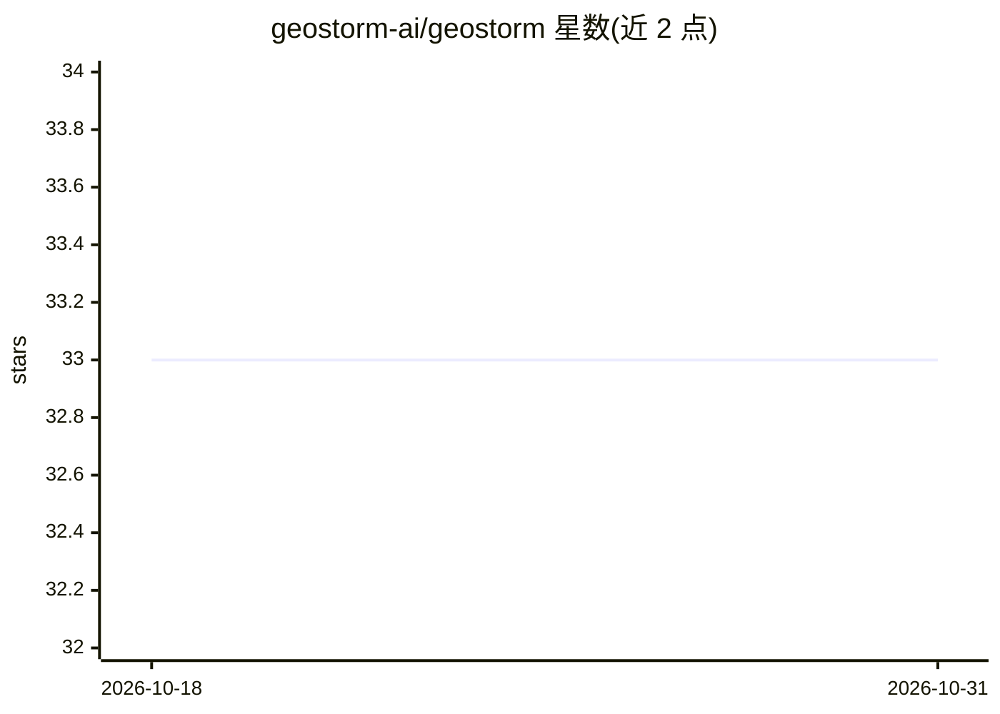

# geostorm-ai/geostorm

⭐ 33 · Python · MIT · 推送 2026-03-05 · [GitHub](https://github.com/geostorm-ai/geostorm) · [官网](http://geostorm.ai/) · 组织维护

**自托管工具：监控各 AI 模型如何推荐你的软件**

单容器自托管的 AI 感知监控工具：按计划通过 OpenRouter 查询 GPT、Claude、Gemini 等模型（也可用 OpenAI/Anthropic/Google 直连 key），追踪模型对指定软件的推荐份额与排名位置，并在出现新竞品、停止被提及、份额下降、排名退化、模型间分歧等信号时告警。后端 FastAPI + APScheduler，SQLite 存储，前端 Astro + React；通过 /mcp/ 端点供 Claude Code 对话查询数据，支持 Slack/邮件/Webhook 通知。仅自托管，无托管版。

## 筛选速览

| 维度 | 判定 | 备注 |
|---|---|---|
| AI 角色 | `ai-ecosystem` | LLM/agent 周边工具 |
| 许可风险 | `permissive` | MIT |
| 部署形态 | `self-host` | docker 或自建部署 |
| 模型依赖 | locked-api |  |
| 硬件要求 | — | 无带数字的原话,不猜 |
| 安装摩擦 | `low` | 无编译、无系统依赖或容器化 |
| 成熟度 | — | 结构信号不足 |

## 能力要点

- 5 类告警：竞品出现、停止提及、推荐份额下降、排名退化、模型分歧
- 经 OpenRouter 单 key 查询多模型，也可用直连 provider key
- 暴露 MCP 端点供 Claude Code 查询感知数据（4 个工具）
- 单 Docker 容器部署，SQLite 存储，无外部依赖

## 适用场景

- 跟踪自家开源项目在 AI 回答中的被推荐情况
- AI 推荐位被竞品取代或份额下降时收到告警
- 通过 Claude Code 对话查询感知数据与趋势

## 场景标签

 · 领域:开发者工具/AI 监测

## 证据(README 行号)

> L25: GeoStorm monitors multiple AI models on a schedule, tracks how they perceive and recommend your software, and alert
> L96: |**Backend**|FastAPI serving the REST API and running scheduled monitoring jobs via APScheduler (in-process)|
> L105: GeoStorm exposes an MCP endpoint at `/mcp/` so AI coding assistants like Claude Code can query your perception dat

## 星数曲线

2026-10-18 33 → 2026-10-31 33（+0）

---
*卡片 v1 · prompt 1.4 · 生成 2026-10-25 · 置信度 high · 依据 README sha `9fa464c14e02` · [字段定义](../../DATASET.md)*
